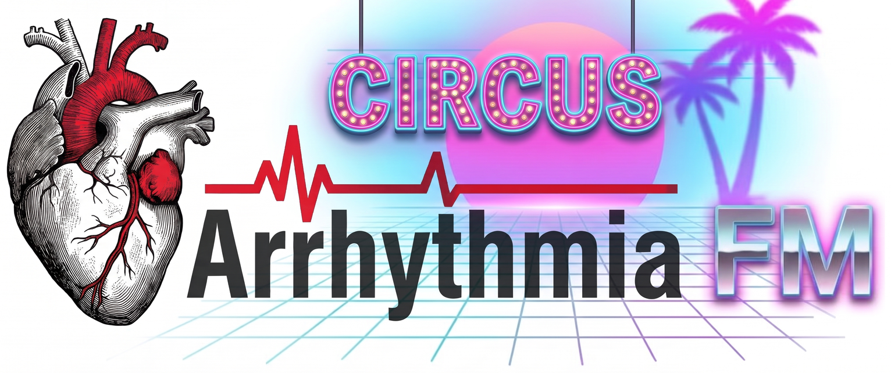

# Circus Arrhythmia FM

Circus Arrhythmia FM is a patch for the firmware of the Novation Circuit Rhythm. It corrects bugs and adds functions.

Current release: **0.3.1** ([release notes](RELEASE-NOTES-0.3.1.md)). Project objectives: [principles](docs/user/principles.md).

Arrhythmia is not affiliated with Novation or Focusrite. Novation and Focusrite do not endorse Arrhythmia.

## Install

Before you start, make a backup of the microSD card ([procedure](docs/user/install.md#back-up-first)).

1. Download the Novation firmware 2.0.1: <https://components.novationmusic.com/api/v2/firmwares/169/file>.
2. Close Novation Components and all other music applications.
3. Connect the unit to the computer with a USB cable.
4. Open <https://llcoolkm.github.io/arrhythmia/web/> in Chrome.
5. Click **Connect MIDI**.
6. Select the downloaded file.
7. Click **Install**.
8. When **Play** flashes on the unit, push **Play**.
9. To play the FM synthesizer on track 8, add the FM engine file `fm.dse` to the card
   ([engines](docs/user/synth.md#engines-on-track-8)).

Troubleshooting, other download procedures and the return to stock: [install guide](docs/user/install.md).

## Bug fixes

* **Parameter locks.** On the stock firmware, a parameter lock stays active on the next steps until you turn the
  knob. In Arrhythmia, a step without a lock uses the knob value.
* **Sound processor fault.** On the stock firmware, the unit can stop when the sound processor does not answer.
  Arrhythmia limits the wait for an answer. After a timeout, **Rec** flashes white
  ([procedure](docs/user/install.md#rec-blinks-white)).

## Functions

The synthesizer functions are in arrhythmia-firmware only.

* **Engines on track 8.** Each card pack makes track 8 play either its samples or an engine. The FM synthesizer is
  the engine file `fm.dse`, a 4-operator FM synthesizer designed for 4 voices. A file on the card selects the engine of a
  pack, and a default file selects it for all packs without a selection
  ([engines](docs/user/synth.md#engines-on-track-8)). Any engine file that passes the checks of engine ABI 3 loads;
  authors read [engines for developers](docs/user/engines-dev.md).
* **FM feedback.** Macro 1 of track 8 sets the feedback up to 8x and acts on sounding notes
  ([macros](docs/user/synth.md#macros-on-track-8)).
* **Arpeggiator on track 8.** Page 3 of the synth page turns the arpeggiator on or off and sets mode, latch, rate,
  octaves and gate ([arpeggiator](docs/user/synth.md#the-arpeggiator)).
* **Synth recovery after sample loading.** After a pack change or a sample load, the synth starts again
  automatically ([loading samples](docs/user/synth.md#loading-samples-while-the-unit-runs)).
* **Sound selection in the Sample view.** With the FM engine, the 16 pads of rows 3 and 4 in the Sample view of
  track 8 select one of 16 ratio families. Page 1 uses the serial algorithm. Page 2 uses the dual stack algorithm. A tap selects the sound
  and plays it. Sample flips select the sound per step
  ([choosing a sound](docs/user/synth.md#choosing-a-sound-the-sample-view)).
* **Envelope and tone controls.** On track 8, macros 1 to 8 set feedback, attack, decay, sustain, release, FM depth,
  filter cutoff and resonance. MIDI CC 21 to 28 and parameter locks operate on all eight
  ([macros](docs/user/synth.md#macros-on-track-8)).
* **Synth page.** Shift + Track 8 opens the synth page. Page 1 sets chords. On page 1, macros 1 to 4 set tune,
  modulator attack, modulator decay and modulator floor. Page 2 sets scales, scaled tracks and key. Page 3 sets the
  arpeggiator. A view or track button closes the page and does its normal function. Clear + macro sets the default
  of that macro ([synth page](docs/user/synth.md#the-synth-page)).
* **Chords on track 8.** Each pad and each sequencer step plays 1 to 4 notes. With 1 note per press and poly on,
  held pads sound together.
* **MIDI polyphony on track 8.** MIDI notes on the channel of track 8 play on the synthesizer.
* **Scales on tracks 1 to 7.** The Note view uses one of eight scales (ten in arrhythmia-devkit)
  ([scales](docs/user/scales.md)).
* **Modules.** Small programs on the microSD card control the pads, lights, notes and MIDI. The release has 10
  modules: paint, games, a light show and modules that play notes ([modules](docs/user/modules.md)). To write a
  module, refer to [developers](docs/user/developers.md).
* **Engine and module loader.** The [loader](https://llcoolkm.github.io/arrhythmia/web/loader.html) manages engines
  and modules on the microSD card over USB. It lists pack folder names and engine versions, adds or updates the FM
  engine, and sets engine selections ([engines](docs/user/synth.md#engines-on-track-8)). Load packs on the unit in
  the stock Packs view. The firmware installer remains a separate page.

## Limits

* Track 8 plays the FM synthesizer only when the pack selects the FM engine. Without an engine, it plays the
  samples of the pack.
* The synthesizer has 32 sounds: 16 ratio families under 2 algorithms. It has no presets. With the FM engine, the
  Sample view of track 8 has 2 pages.
* Engine selection changes apply on the next pack load. Save project edits before loading a pack.
* At high pitch, the ratio families fade to a plain tone and sound alike
  ([known issues](docs/user/synth.md#known-issues)).
* With the FM engine, sample flips stored on track 8 in older projects and factory patterns change the sound on those
  steps.
* The synthesizer is designed for a maximum of 4 voices; the physical count and stealing order are unmeasured. A note that fades out after its release occupies a voice.
* During a sample load (a pack change, or a sample transfer or load including SysEx read-back), the synth stops and
  its sounding notes stop. The synth starts again after the load. If the restart fails, the synth is silent until a
  power cycle ([loading samples](docs/user/synth.md#loading-samples-while-the-unit-runs)).
* The synth output is decreased by a fixed amount. Set the balance with the mixer level of track 8
  ([output level](docs/user/synth.md#output-level)).
* Arrhythmia is not for the Circuit Tracks or for other firmware versions of the Circuit Rhythm.

## Two images

| Image | For | Contents |
|---|---|---|
| **arrhythmia-firmware** (build 7388) | users | Track 8 engines (FM synthesizer as a card file), arpeggiator, scales, bug fixes, modules |
| **arrhythmia-devkit** (build 7228, unchanged from 0.1.0) | developers | DSP load meter, module tools, scales, bug fixes. No synthesizer. |

If you are not sure, install **arrhythmia-firmware**.

Rebuild from source: [current image](docs/README.md#rebuilding-the-images) and
[0.1.1 image](docs/README.md#rebuild-the-011-firmware-image-7261).

## Requirements

* A Circuit Rhythm with firmware 2.0.1 (build 5706) and bootloader 4799.
* The official firmware file 5706 from Novation.
* Chrome on Windows or Linux, or Python 3.12 on Linux. macOS is not tested.
* A USB cable and a microSD card reader.
* For the FM synthesizer: the file `fm.dse` 2.0.0 from the release page.

## Return to stock

Use **Back to stock** on the installer page, or `tools/flash.py` on Linux
([procedure](docs/user/install.md#going-back-to-stock)). Novation Components cannot do this.

## Risks

* You install modified firmware at your own risk.
* Make a backup before the installation.
* A very high load can cause audio errors.

## Licence

MIT ([LICENSE](LICENSE)). The licence applies only to the Arrhythmia code and documents. It does not apply to the
Novation firmware.

## Acknowledgements

[CIRCUITS-HACKS-RC](https://github.com/Ghillermo/CIRCUITS-HACKS-RC) by Ghillermo, a community modification for the
Circuit Tracks, gave useful information. Arrhythmia is a separate project.
