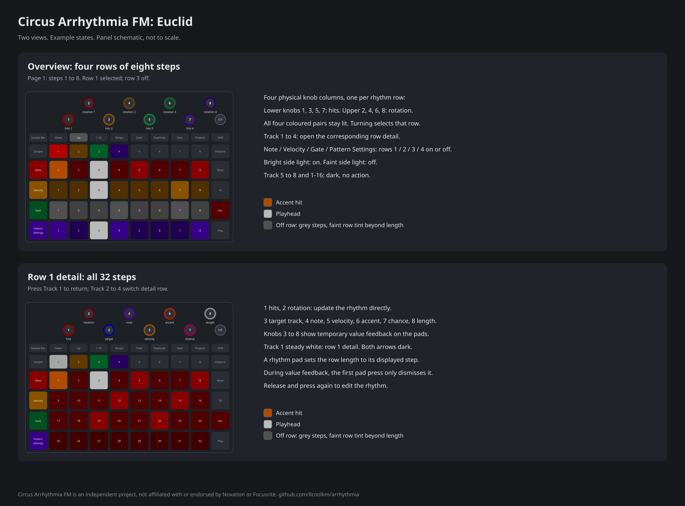
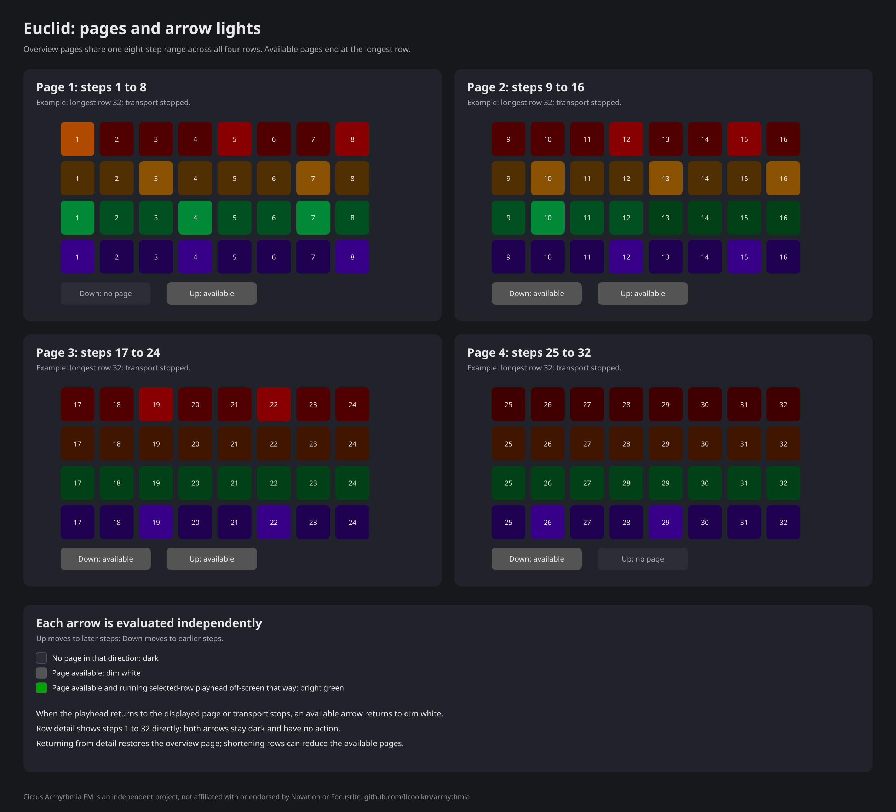
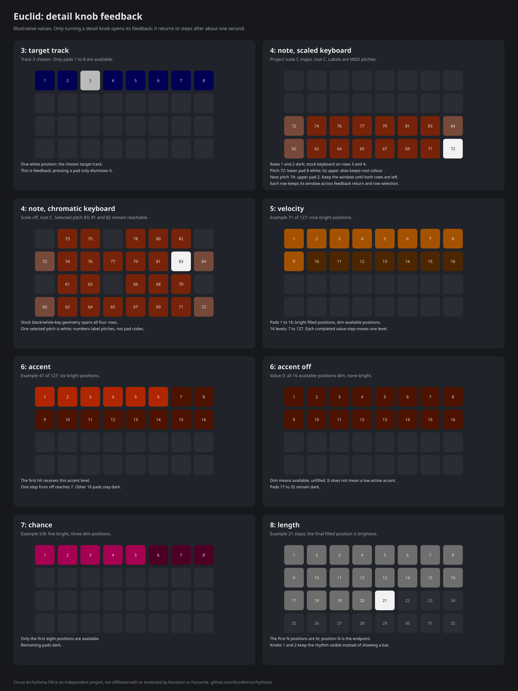
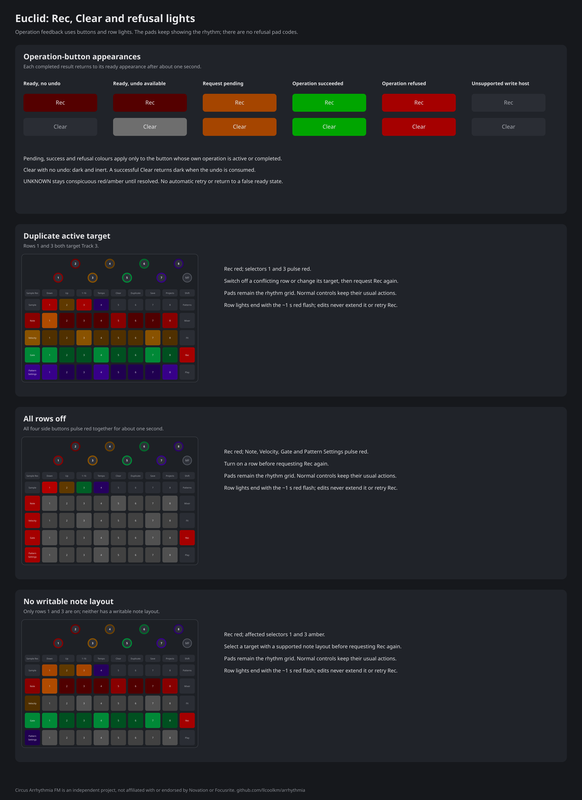

# Circus Arrhythmia FM: Euclid

Applies to Circus Arrhythmia FM 0.3.0, firmware build 7358. Test status and known limitations: see the
[release notes](../../RELEASE-NOTES-0.3.0.md#known-limitations).

Four rhythm rows of up to 32 steps, as a four-track drum machine. Each row spreads its hits as equally as possible
across its steps (a Euclidean rhythm). Rows 1 to 4 play tracks 1 to 4 at the start.

The illustrations on this page are schematics of the controls and lights, not captures from the unit.

## Open and play Euclid

1. Turn stock **Record off** before opening Euclid if you plan to write patterns with its Rec button.
2. Press **Shift + Sample Rec** to open the module picker.
3. Press pad 10 to open `10euclid.mod`. Euclid opens in overview.
4. Press **Play** to start the rhythms.

Press **Play** again to stop the transport. Press **Shift + Sample Rec** to close Euclid; see
[Start and stop a module](modules.md#start-and-stop-a-module) for installing and opening modules.

## The two views

In **overview**, four rows of eight pads show rows 1 to 4 on a shared page. **Up** shows the next eight steps and
**Down** the previous eight: 1 to 8, 9 to 16, 17 to 24 or 25 to 32, up to the longest row.

* Press **Track 1 to 4** to open that row's **detail** view. All 32 pads show its steps. Press the same Track again
  to return to overview, or another Track to change the detail row. Returning to overview restores its page.
* Press a rhythm pad to select its row and set its length to that step. For example, on overview page 9 to 16,
  the fifth pad of row 2 sets row 2 to 13 steps.
* **Note, Velocity, Gate and Pattern Settings** toggle rows 1, 2, 3 and 4 respectively, in either view. A row that
  is off plays no module notes and is excluded from the next Rec write. Its assigned track still suppresses
  stock pattern notes and sample flips while Euclid is open.
* **Track 5 to 8** and **1-16** are dark and have no function in either view, including during value feedback.
* Rec writes patterns and Clear undoes the last write ([Write and undo patterns](#write-and-undo-patterns)).

## Set a row length

1. Press the row's **Track 1 to 4** button to show its 32 steps in detail.
2. Press the step where the row must end. For example, pad 13 sets a 13-step row.
3. Press the same **Track** button to return to overview.

In overview, a pad sets the length to the displayed step of its row. On page 9 to 16, the fifth pad of row 2 sets
row 2 to 13 steps. A pad sets length, rather than adding or removing an individual hit. Releases do nothing.

Overview pages extend only through the longest row. Shortening rows can move the page back to the last available
page. Detail always shows all 32 steps and its arrows have no function.

## The macro knobs

In overview, each knob column controls one row. The lower knob sets its hits and the upper knob its rotation:

| Row | Hits | Rotation | Colour |
|---|---|---|---|
| 1 | macro 1 | macro 2 | red |
| 2 | macro 3 | macro 4 | yellow |
| 3 | macro 5 | macro 6 | green |
| 4 | macro 7 | macro 8 | violet |

Hits range from 0 to the row length, starting at 1, 2, 3 and 4 for rows 1 to 4. Rotation starts at 0 and moves
hits to later steps, up to length minus 1. Turning an overview knob selects its row without opening detail.

In detail, the knobs edit only the displayed row:

| Macro | Value | Range | Start value |
|---|---|---|---|
| 1 | hits | 0 to row length | row 1: 1 to row 4: 4 |
| 2 | rotation | 0 to length minus 1 | 0 |
| 3 | target track | 1 to 8 | row 1: track 1 to row 4: track 4 |
| 4 | note | reachable pitches of the target keyboard, up to 24 choices | lowest choice |
| 5 | velocity | 16 levels, 7 to 127 | 96 |
| 6 | accent | 0 (off), then 16 levels, 7 to 127 | 0 |
| 7 | chance | 1 to 8 (eighths) | 8 |
| 8 | length | 1 to 32 steps | 8 |

Detail knobs 1 and 2 update the displayed rhythm directly. Turning knobs 3 to 8 briefly replaces the steps with
value feedback. About one second after the last turn, the steps return. A pad press during value feedback
only dismisses it; release and press again to set a step length.

* **Target:** pads 1 to 8 show tracks 1 to 8, with the selected track white.
* **Note:** the pads show the target keyboard's stock layout and root-note colours for the project's scale.
  The scaled keyboard uses the bottom two rows; the chromatic keyboard keeps its black/white-key positions.
  One position for the chosen pitch is white. If the keyboard has two positions for it, the lower one takes
  the white marker and the other keeps its normal colour, including root-note emphasis. The knob moves
  through reachable pitches from low to high without wrapping. After the last pitch of the lower row, the next
  pitch appears on the upper row. Each row keeps its own display window: in a scaled keyboard it moves only
  when the pitch leaves both keyboard rows, choosing a new window nearest the previous display register.
  The first window is chosen from the target's Note-view register and selected pitch; it does not always
  start on the bottom row.
  Returning from feedback or selecting another row preserves the window. Changing target or keyboard layout
  starts a fresh window. Changing target clamps the note if needed; changing the stock Note view's octave
  does not retune Euclid's notes. The display never changes that track's Note-view octave. Scaled keyboards
  leave the top two rows dark; chromatic keyboards use all four rows. An unavailable keyboard stays dark and plays no note.
* **Velocity and accent:** the first 16 pads form a level bar. Available unfilled positions are dim;
  the other 16 pads are dark. The 16 positive levels are 7, 15, 23, 31, 39, 47, 55, 63, 71, 79, 87, 95, 103,
  111, 119 and 127. One completed encoder value-step moves one level, without acceleration.
  Accent at 0 is off: all 16 available positions are dim; one upward step sets 7. Above 0 it sets the first
  hit's velocity in each row cycle; it can be softer or louder than the other hits. Other hits use the row velocity.
* **Chance:** the first 1 to 8 pads show the chance in eighths, with other available positions faint.
  The remaining 24 pads are dark. At 8, every hit plays.
* **Length:** the first 1 to 32 pads show the length, with the last step brightest and the remaining pads dark.
* A value change releases sounding notes. Detail knobs 1 and 2 use the selected row’s overview colours.

Imported and retained velocity and accent values stay unchanged until the first completed encoder value-step. That step
rounds to the nearest level (ties upward, including accent's off value), then moves in the turned direction.
For example, the starting velocity 96 becomes 103 upward or 87 downward; upward can initially leave its 13-pad
bar unchanged. Later steps follow the levels above, with one bright pad per positive level; a loaded value's
full bar does not necessarily mean 127.

## Change a row's target and note

1. Press its **Track 1 to 4** button to open detail.
2. Turn **macro 3** to choose the target track. The first eight pads show the choice.
3. Turn **macro 4** to choose a note. One key is white in the target's keyboard layout.
4. Wait about one second for the steps to return.
5. Press the same **Track** button to return to overview.

Knobs 3 to 8 show feedback, rather than a pad keyboard or pad editor. Pressing a pad while feedback is visible
only dismisses it; release and press again to set the length. Turning detail knob 1 or 2 also returns to the
steps and edits hits or rotation. Side toggles and Track 1 to 4 keep their usual functions during feedback.
Track 5 to 8 and 1-16 remain dark and inactive in every view and overlay. Releasing a Track button does not change views. **Shift**, master filter and master volume keep their normal functions.

## Clock and notes

* **Clock.** Press Play to start. One step is a sixteenth note. A note lasts half a step.
* Each row repeats in its own length and continues over the bar line: a row of 5 steps starts its third cycle
  on step 11 of the bar and its fourth cycle on step 16. Play starts all rows at their first step. If the module
  starts while the transport runs, the rows count from the start of that bar.
* If two rows play on the same track on the same step, the upper row plays. If chance stops that hit, the lower
  row plays. A row that is off does not play.
* **MIDI out.** Notes go to MIDI out on the target track's MIDI channel, as notes from the pads.

## Settings and saved patterns

Euclid retains row values, rows on and off, the selected row and a valid overview page when it closes. It always
reopens in overview. These settings are kept in RAM, not in the project. Power loss or loading or writing another
large file through the unit can replace them; this includes an FM engine update. Saved patterns can restore only
the representable fields described below.

In arrhythmia-firmware 0.3.0, Euclid also reads the current patterns of its target tracks when it starts: at the
first start after power on, and at the first start after a project load. A row takes the values of its track's
pattern when all of these are true:

* At least one step is on, and the steps that are on form a Euclidean rhythm over the pattern length.
* All active steps use the same reachable keyboard note (within Euclid's 24 choices), microstep 1 only and the
  same valid step probability (0 to 7, shown as chance 1 to 8).
* All active steps have one velocity from 1 to 127, except that the first hit can have another velocity in that
  range. The pattern's start and end steps must each be 0 to 31; a pattern can wrap past step 32.

| Row value | From the pattern |
|---|---|
| length | the pattern length |
| hits, rotation | the steps that are on |
| note | the keyboard note |
| velocity | the velocity of the hits after the first |
| accent | the velocity of the first hit, if different |
| chance | the step probability |

A row whose pattern does not match keeps its values. Reading changes only Euclid's rows, not the project.
A zero-hit pattern is not adopted. Symmetric rhythms and full-hit patterns can have equivalent rotations;
Euclid takes the first matching rotation. With one hit, its velocity becomes the normal velocity and accent is
off. Patterns do not store the target-row mapping, rows on and off, overview page or selected row.

Until you load a project again, reopening Euclid keeps retained settings instead of reading over them.
An older Euclid module may discard retained row settings that use the three newly available highest notes.
Input before the opening read completes also preserves the user's values. A refused or unanswered read leaves
the rows unchanged. Rec and Clear are ignored until the opening read finishes or is withdrawn; pressing them
while waiting does not queue a later write.

## Write and undo patterns

In arrhythmia-firmware 0.3.0, **Rec** writes each row that is on to the current pattern of its target track. This
changes pattern data; save the project if you want to keep those patterns.

**Keep stock Record off before opening Euclid for this workflow.** If Record is already armed, Euclid's live
notes also go into the stock recorder while Play runs. **Clear does not undo earlier live recording:** it undoes
only the last explicit Rec write.

* Hits set note, velocity (or accent), chance and microstep 1; rests turn steps off. Rec sets the pattern length
  to the row length, starting at the pattern's start step. Gate, sample flip, parameter locks, rate and direction stay.
* Use a different target track for each active row. Active rows sharing a writable target refuse the write;
  change a target or turn a conflicting row off before pressing Rec again.
* Rec selects the active rows when pressed. Turning a row off afterward affects live play and the next Rec,
  without cancelling the requested write. Values are taken when its initial pattern read completes, so knob
  edits during that wait can enter the write.
* **Clear** restores the patterns, including their lengths, from before the last successful Rec while Euclid
  remains open. A local refusal that writes nothing preserves the previous undo.
* Rec can be used with playback running or stopped. While Euclid runs, all four assigned target patterns,
  including those of rows that are off, play no notes or sample flips; their parameter locks still run. A hit
  is skipped while a sequencer note is still held or during the first step after selecting a new target. Live
  pad/MIDI notes and existing effect tails are not muted by this pattern suppression. Changing a target
  releases the old target from suppression only when no row still targets it. Closing Euclid lets all target
  patterns play again.
* On devkit 7228 and older hosts without pattern-write support, Rec and Clear are dark and have no function,
  and Euclid does not read patterns when it starts.

Rec is **dim red** when ready. Clear is **white** when an undo is available and otherwise dark. A pending operation
shows its button amber. Success flashes that button green for about one second; refusal flashes it red for about
one second, whether playback is stopped or running. It then returns to its ready appearance. A successful
Clear consumes the undo, so its green flash ends in dark. Pressing dark Clear without an undo does nothing; it does not flash a refusal.

During a refusal flash, conflicting rows' Track selectors pulse red; if all rows are off, Note, Velocity, Gate
and Pattern Settings pulse red together in the same rhythm. Rec stays red during either refusal. If no active
row has a writable note layout, the affected Track selectors turn amber. The pads
continue to show the steps; selectors, toggles and normal editing keep their usual actions. These row indications
end with the red flash. Correcting the cause never retries Rec automatically. An active row with an
unsupported keyboard is not written; other active writable rows can still write if their targets differ. Other refusals, such as a busy
unit or a changed project or pattern, flash the operation button red without inventing a row-light reason.
A busy refusal is complete: amber does not remain lit afterward. Editing or navigating during a completed
result flash does not extend it. Starting Rec or Clear dismisses any ordinary value overlay and shows the steps.

An **unknown outcome** remains conspicuously red/amber until resolved. Wait before further edits; Euclid does not
automatically retry an uncertain write. Rec and Clear cannot start another operation while one is pending
or unresolved. This is different from a completed refusal's brief red flash.

## Write a beat into the patterns

1. Turn stock **Record off**.
2. Open Euclid from pad 10 of the picker.
3. Set each row's hits with its overview hits knob.
4. Set each row's rotation with its overview rotation knob.
5. Open a row's detail with its **Track** button if you need to change its target, note or other values.
6. Turn the detail knob for the value you want to change.
7. Press the same **Track** button to return to overview.
8. Press a row's side button to turn it off if it must not write.
9. Press **Rec** to write the active writable rows.
10. Wait for its green success flash.
11. Press **Shift + Sample Rec** to close Euclid. The tracks can now play their written patterns.
12. Save the project to keep the patterns.

Repeat steps 3 to 7 for other rows as needed. Playback may be running or stopped for Rec.
Press Play if you want to audition your changes before writing.

## Undo the last explicit write

1. Keep Euclid open after the successful **Rec** write.
2. Press **Clear** while it is white.
3. Wait for its green flash.

Clear restores the actual patterns and their start/end lengths from immediately before that Rec, rather than
setting a default length. A successful undo consumes the undo: Clear returns to dark. Dark Clear does nothing,
including during existing feedback. Only one explicit write can be undone, in the same open module instance;
closing Euclid loses that undo. A new write attempt that starts reading patterns replaces the previous undo.
Clear cannot remove notes already put into patterns by stock live recording before Rec.

## Lights

* Overview has four row-colour bands; detail uses its row's colour across all 32 steps. Hits are bright, accent
  hits amber and the current step white. Rests are dimmer, and positions beyond a row's length are faint.
* Off rows retain their faint colour tint with grey steps and no playhead. Their side buttons are faint in the
  row colour; an on row's side button is bright.
* Overview knobs form four row-colour pairs, with hits brighter than rotation. The selected Track uses its row
  colour. In detail, Track N is steady white, knobs 1–2 use that row’s hits/rotation colours, and knobs 3–8 are
  blue, violet, amber, orange, pink and white respectively. Other row selectors are dim in their row colours.
* Each overview arrow is dim white when a page is available in that direction, stopped or playing. It turns
  bright green while the selected row's running playhead is off-screen in that direction. An unavailable arrow
  is dark. Both arrows are dark and inactive in detail.

## Record on older hosts

On devkit 7228 and older hosts without pattern-write support, Euclid takes the Rec button while open.
Arm Rec before opening it:

1. Press **Rec** before opening Euclid to arm stock recording.
2. Press **Play** to start the transport.
3. Open Euclid from pad 10 of the picker. Its hits enter the target tracks' patterns.
4. Close Euclid with **Shift + Sample Rec** after one bar.

**CAUTION:** While Euclid stays open with Rec armed, it records its hits again each bar. The pattern then plays
the recorded steps and Euclid plays the same hits on the same track: each hit plays twice and goes to MIDI out
twice. Close Euclid after one bar of recording.
