# Circus Arrhythmia FM: the modules on the microSD card

Applies to Circus Arrhythmia FM 0.2.2, firmware build 7339. Test status: see the
[release notes](../../RELEASE-NOTES-0.2.2.md#test-status).

A module is a small program that runs on the unit. The release has 10 module files. Each file name starts with a
number: that number is the pad of the module in the picker.

| Pad | File | Module | Clock | Sound |
|---|---|---|---|---|
| 1 | `01paint.mod` | [Paint](#paint-pad-1) | no | yes |
| 2 | `02euclid.mod` | [Euclid](#euclid-pad-2) | yes | yes |
| 3 | `03life.mod` | [Life](#life-pad-3) | yes | yes |
| 4 | `04rain.mod` | [Rain](#rain-pad-4) | yes | yes |
| 5 | `05balls.mod` | [Balls](#balls-pad-5) | yes | yes |
| 9 | `09pulse.mod` | [Pulse](#pulse-pad-9) | yes | no |
| 10 | `10stars.mod` | [Stars](#stars-pad-10) | no | no |
| 17 | `17snake.mod` | [Snake](#snake-pad-17) | no | no |
| 18 | `18lights.mod` | [Lights Out](#lights-out-pad-18) | no | no |
| 19 | `19mole.mod` | [Whack-a-mole](#whack-a-mole-pad-19) | yes | no |

"Clock: yes" means that the module follows the sequencer clock. Push **Play** to start it.

## Put the modules on the card

1. Power the unit off and remove the microSD card. Put the card in a card reader. The USB drive of the unit does not
   show the card.
2. At the root of the card, make a folder `Modules`. The name is not case-sensitive.
3. Copy the `.mod` files into that folder. Keep the file names. The number at the start sets the pad
   ([File names and pads](#file-names-and-pads)).
4. Put the card back and power the unit on. The card must be present at power-on.

The picker only reads the card. It does not change your projects or samples.

## File names and pads

The picker shows up to 32 module files, on pads 1 to 32. Pad 1 is top left, pads 1 to 8 are the first row.

* A module file is a file in the folder `Modules` with the extension `.mod` and a size of 26 to 15,360 bytes. Use
  short names: up to 8 characters before `.mod`. The picker uses the short (8.3) name of a file. Hidden and system
  files are not shown.
* A name that starts with two digits `01` to `32` (for example `07drums.mod`) puts the file on that pad.
* If two files have the same number, the first in the list gets the pad. The other file goes on the lowest free pad.
* A file without a number (or with `00` or `33` to `99`) goes on the lowest free pad.
* The list order: first the files with a number, then the other files. Each group is in character order of the name.
* With more than 32 files, only the first 32 in the list order are shown.
* The colour of a pad comes from the name without the number. The number does not change the colour.

## Add modules with the web page

Open the page `web/modules.html` in Chrome.

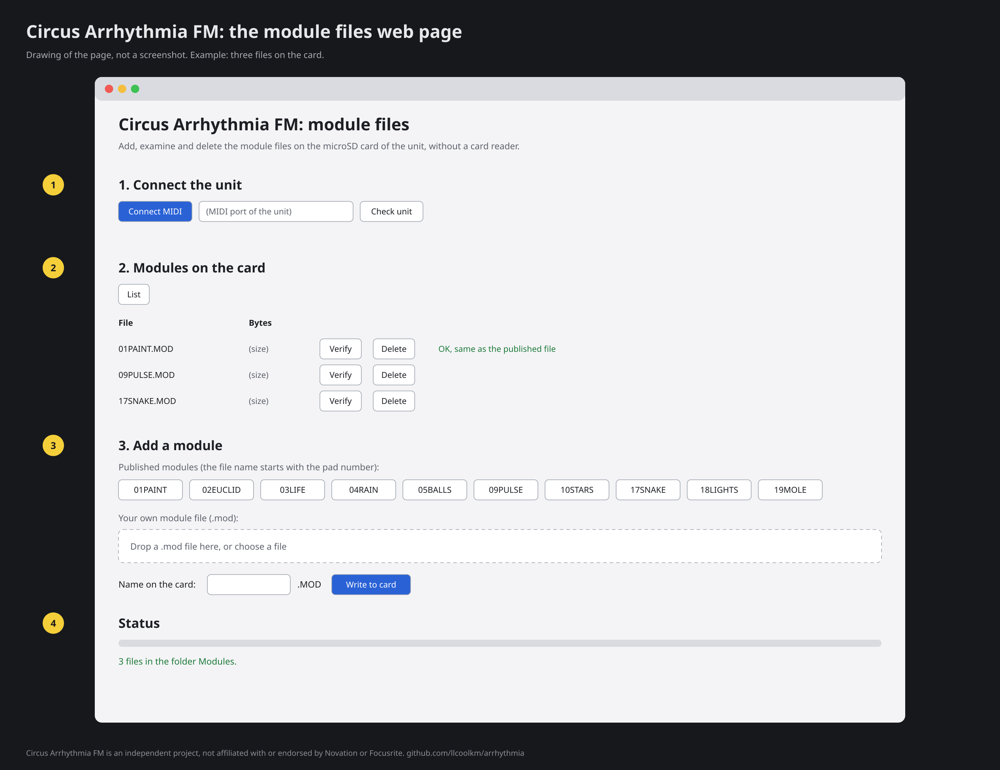

The page writes module files to the card over USB, without a card reader. It requires Chrome with Web MIDI and
SysEx, and a firmware with the card writer. Without the card writer, the page sends nothing to the card.

1. **Connect the unit.** Close other music apps. Connect the unit by USB and stop playback. Select **Connect MIDI**,
   select the port of the unit, then **Check unit**.
2. **Modules on the card.** **List** shows the files in the folder `Modules`. **Verify** reads a file back and
   compares it with the published file. **Delete** removes a file.
3. **Add a module.** Push the button of a published module, or drop your own `.mod` file and give it a name. Then
   **Write to card**. The name has 1 to 8 characters: A to Z, 0 to 9, `_` and `-`. The page adds `.MOD`. Start the
   name with `01` to `32` to put the module on that pad ([File names and pads](#file-names-and-pads)). The published
   modules keep their numbers.
4. **Status.** The page shows the progress and the result of the last job.

A card command stops a running module.

## Start and stop a module

**Shift + Sample Rec** opens the picker.

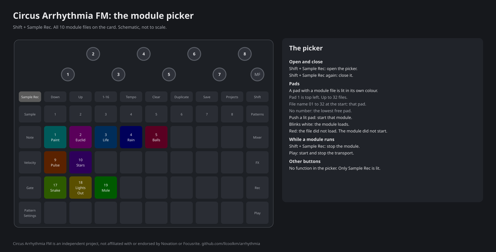

* A pad with a file comes on in its own colour. Pads without a file stay dark. With no card, no folder `Modules` or no module file, no pad
  comes on.
* Push a lit pad to start that module. The pad that loads blinks white.
* A red pad means that the file did not load: it failed its checks, or the unit could not read it. The module does
  not start. The picker stays open.
* Other buttons and the macro knobs do not control the picker. Play controls the transport. Only Sample Rec is lit.
* **Shift + Sample Rec** in the picker closes the picker.
* **Shift + Sample Rec** while a module runs stops the module. The normal lights and controls come back at once.

No module stops automatically. No module starts automatically at power-on.

## While a module runs

* **Play** always starts and stops the transport.
* A module that follows the clock waits for **Play**. While it waits, the Play button blinks dim green. When the
  transport stops, its clock-driven activity stops and its notes are released. The module stays open with idle lights.
* Most modules take the pads, the buttons and the macros. **Shift**, Shift + Sample Rec, the master filter and the
  master volume stay normal.
* Pulse and Stars do not take the controls. The pads, buttons and macros operate normally. The lights show the
  module.
* In all modules except Paint, one value step of a module macro needs four encoder counts. Small knob bounces do not
  change the value. Paint uses the encoder counts directly.

## Notes from the modules

Euclid, Life, Rain and Balls play notes on a selected target track. These rules apply to all four:

* The notes come from the Note view keyboard of the target track. The module uses the notes that the keyboard shows
  in the two octaves from the original pitch of the sample up. Degree 0 is the lowest of these notes. The higher
  degrees go up through these notes. After the highest note, the count starts again at the lowest note.
* With scales on (tracks 1 to 7), the notes are in the scale ([scales.md](scales.md)).
* If the module cannot read the keyboard of the track (for example a slice layout), it plays no notes on that track.
* Each track plays one module note at a time. A new note on the same track ends the note before it.
* The notes play the sound of the track only. They do not go to MIDI out, and the pattern does not record them.
* On track 8, arrhythmia-firmware plays the synth ([synth.md](synth.md)).

Paint plays notes differently ([Paint](#paint-pad-1)).

## Paint (pad 1)

Start: pad 1 in the picker.

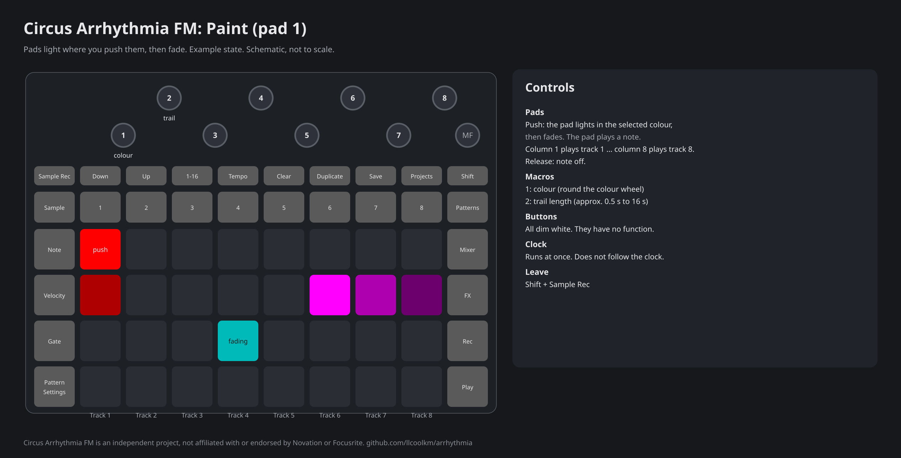

Pads light where you push them, then fade. Each pad also plays a note.

* **Pads.** A push lights the pad in the selected colour. The light then fades.
* **Sound.** A push plays note 60 (the sample at its original pitch) on the track of the pad's column: column 1 plays
  track 1, column 8 plays track 8. The velocity is half the velocity of the push. The release of the pad sends the
  note off. A one-shot sample plays to its end.
* **Macro 1:** colour. Turn it to go round the colour wheel.
* **Macro 2:** trail length. Clockwise makes the trail longer, from approx. 0.5 s to approx. 16 s in 28 steps. Start
  value: approx. 1.5 s.
* The other buttons stay dim white.
* Paint does not follow the clock. It runs immediately.

## Euclid (pad 2)

Start: pad 2 in the picker.

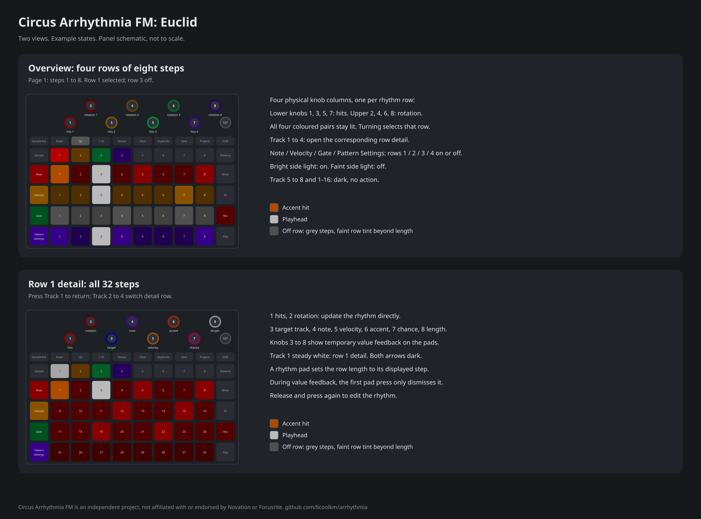

Four rhythm rows of up to 8 steps. Each row spreads its hits as equally as possible over its steps (a Euclidean
rhythm).

* **Pads.** Each pad row is one rhythm row. Push any pad of a row to select that row.
* **Macros 1 to 6** change the selected row:

  | Macro | Value | Range | Start value |
  |---|---|---|---|
  | 1 | hits | 0 to the number of steps | row 1: 1, row 2: 2, row 3: 3, row 4: 4 |
  | 2 | steps | 1 to 8 | 8 |
  | 3 | rotation | 0 to steps - 1 | 0 |
  | 4 | target track | 1 to 8 | row 1: track 1 to row 4: track 4 |
  | 5 | degree | 0 to 20 | 0 |
  | 6 | velocity | 1 to 127 | 96 |

* Rotation moves the hits to later steps.
* A change of a value releases the notes that sound.
* **Clock.** Push Play to start. One step is a sixteenth note. A note lasts half a step. Each bar starts all rows at
  their first step. A row with fewer than 8 steps repeats in its own length in the bar.
* If two rows play on the same track on the same step, the upper row plays.
* **Lights.** While the transport runs, the hits are lit, the current step is white and the selected row has a blue
  tint. Steps past the row length have no hit light, but keep the dim background and selected-row tint. While the
  transport is stopped, the rows show dimly and pulse.

## Life (pad 3)

Start: pad 3 in the picker.

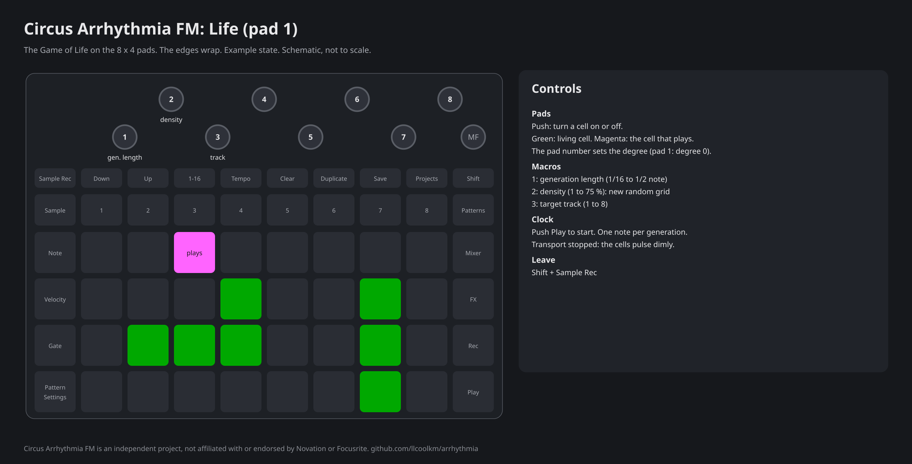

The Game of Life on the 8 x 4 pads. The edges wrap: the left edge touches the right edge, the top edge touches the
bottom edge. A cell with 3 neighbours comes to life. A living cell with 2 or 3 neighbours stays alive.

* **Pads.** Push a pad to turn its cell on or off.
* **Macro 1:** generation length: a sixteenth note (start value), an eighth note, a quarter note or a half note.
* **Macro 2:** density, 1 to 75 % (start value 30 %). Shortly after you stop the turn, the grid fills at random with
  that density.
* **Macro 3:** target track, 1 to 8 (start value 1).
* **Clock.** Push Play to start. Each generation, one living cell plays a note, in turn through the living cells in
  pad order. The pad number sets the degree: pad 1 is degree 0, pad 2 degree 1, and so on. The velocity is 100. A
  note lasts half a generation.
* An empty grid fills again at random at once. A grid that does not change for 4 generations also fills again.
* **Lights.** Living cells are green. The cell that plays has a different colour. While the transport is stopped, the cells pulse
  dimly.
* At the start, three cells in the second row are alive.

## Rain (pad 4)

Start: pad 4 in the picker.

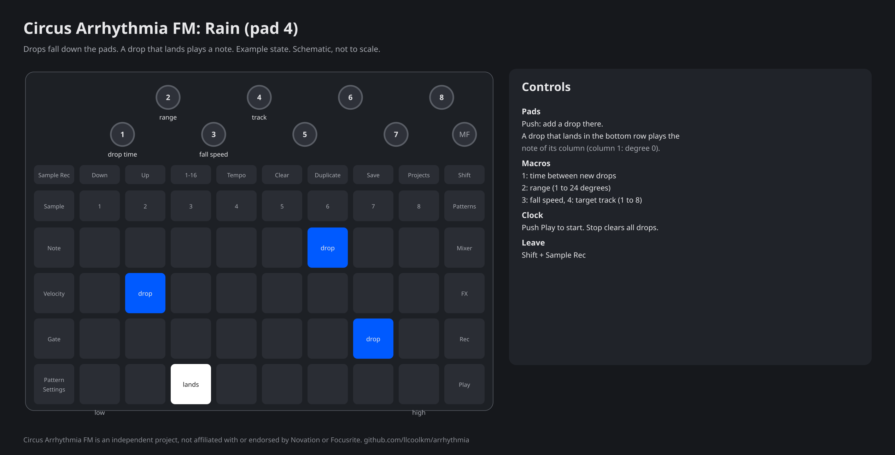

Drops fall down the pads. A drop that lands plays a note.

* **Pads.** Push a pad to add a drop there.
* **Macro 1:** time between new drops: a sixteenth note, an eighth note (start value), a quarter note or a half
  note. Each new drop starts in a random column of the top row.
* **Macro 2:** range, 1 to 24 degrees (start value 8). Column 1 plays degree 0. Column 8 plays the highest degree
  of the range.
* **Macro 3:** fall speed. The drops move down one row each thirty-second note, sixteenth note (start value), eighth
  note or quarter note.
* **Macro 4:** target track, 1 to 8 (start value 1).
* **Clock.** Push Play to start. A drop in the bottom row lands at the next fall step. The velocity is 100. A note
  lasts half a fall step, with a minimum of about 64 ms (six light frames).
* If drops land together, one note plays: the note of the leftmost column. Drops that land while a note sounds
  flash but do not play.
* **Lights.** Drops are blue. A landing flashes white in the bottom row. With no drops, one pad of the bottom row
  pulses dimly.
* Stop clears all drops.

## Balls (pad 5)

Start: pad 5 in the picker.

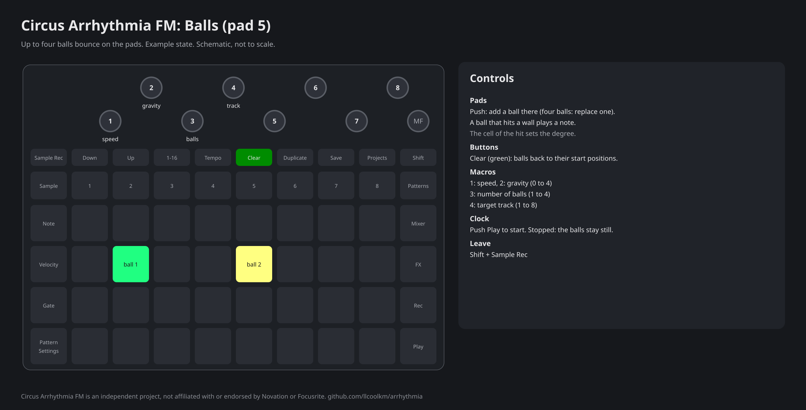

Up to four balls bounce on the pads. A ball that hits a wall plays a note.

* **Pads.** Push a pad to add a ball there. This also increases macro 3 (number of balls). With four balls, a push
  replaces one ball, in turn.
* **Clear** puts the balls back at their start positions. The macro values stay.
* **Macro 1:** speed. One movement each half note, quarter note, eighth note or sixteenth note (start value).
  Clockwise is faster.
* **Macro 2:** gravity, 0 to 4 (start value 1).
* **Macro 3:** number of balls, 1 to 4 (start value 2).
* **Macro 4:** target track, 1 to 8 (start value 1).
* **Clock.** Push Play to start. The cell of the hit sets the degree: pad 1 is degree 0, pad 2 degree 1, and so on.
  The velocity is 96. A note lasts half a movement. If balls hit walls at the same time, one note plays.
* **Lights.** Each ball has its own colour. Clear is lit green.
* While the transport is stopped, the balls stay still.

## Pulse (pad 9)

Start: pad 9 in the picker.

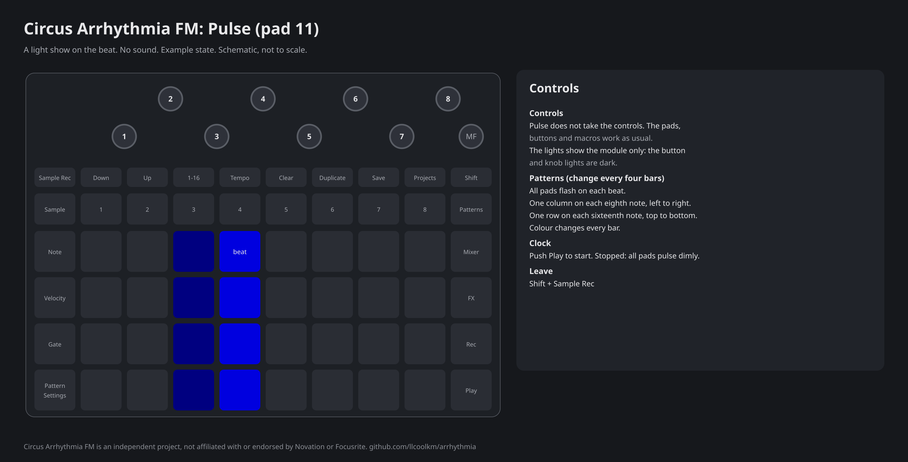

A light show on the beat. Pulse makes no sound.

* Pulse does not take the controls. The pads, buttons and macros operate normally.
* The button and knob lights are dark while Pulse runs.
* **Clock.** Push Play to start. While the transport is stopped, all pads pulse dimly.
* Pulse has three patterns:
  * all pads flash on each beat;
  * one column lights on each eighth note, from left to right;
  * one row lights on each sixteenth note, from top to bottom.
* The pattern changes every four bars. The colour changes every bar: red, yellow, green, cyan, blue, magenta.

## Stars (pad 10)

Start: pad 10 in the picker.

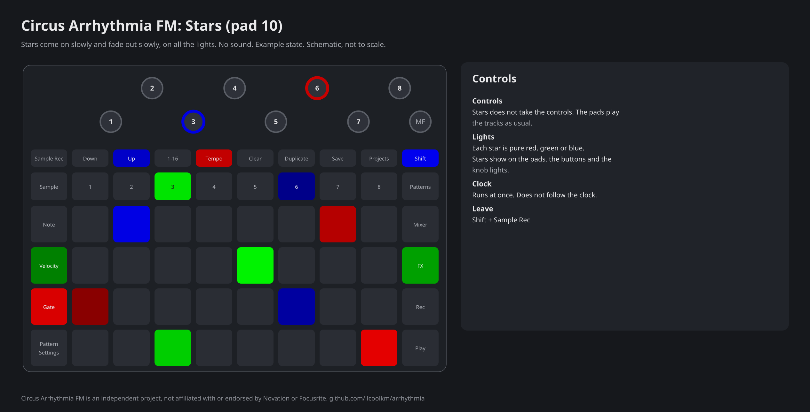

Stars come on slowly and fade out slowly, on all the lights of the unit. Stars makes no sound.

* Stars does not take the controls. The pads play the tracks normally.
* Stars does not follow the clock. It runs immediately.

## Snake (pad 17)

Start: pad 17 in the picker.

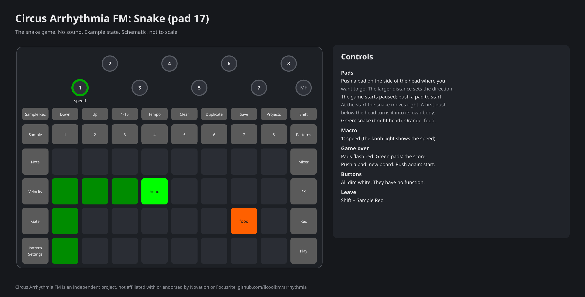

The snake game. Snake makes no sound.

* The game starts paused. The head of the snake blinks. Push a pad to start.
* **Pads.** Push a pad on the side of the head where you want to go. The larger distance (row or column) sets the
  direction. With equal distances, the snake goes up or down. The snake turns once for each move. It cannot
  reverse its direction in one move.
* At the start, the snake moves right and its body is below the head. If your first push is below the head, the
  snake turns into its own body and the game ends.
* **Macro 1:** speed. Clockwise is faster. The light of macro 1 shows the speed. Snake follows the light frames of
  the unit, not the tempo.
* Orange is the food. Green is the snake. The head is bright. The snake grows when it eats.
* The game ends when the snake hits a wall or its own body. It can move into the cell that its tail leaves.
* **Game over.** The pads flash red. The green pads show the score: one pad for each food eaten.
* **Win.** The snake fills the board. The other pads flash blue.
* After approx. half a second, push a pad to show a new board. Push a pad again to start. The speed stays.
* The buttons are dim white. They have no function.
* Snake does not follow the clock.

## Lights Out (pad 18)

Start: pad 18 in the picker.

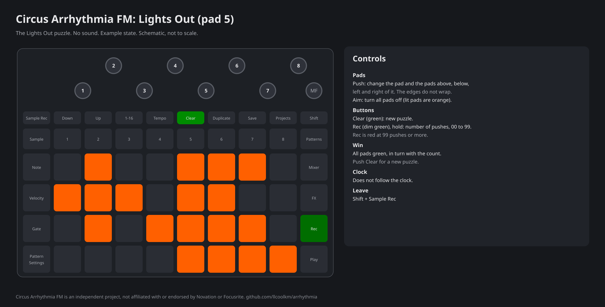

The Lights Out puzzle. Lights Out makes no sound.

* **Pads.** Push a pad to change it and the pads above, below, left and right of it. The edges do not wrap. A push
  flashes white for a moment.
* The aim: turn all pads off. Lit pads are orange.
* **Clear** starts a new puzzle. Each puzzle is made from the solved board, so it always has a solution.
* **Rec.** Hold Rec to see the number of pushes, 00 to 99, as two digits. Rec is lit green. At 99 or more pushes,
  Rec is red and the count stays at 99.
* **Win.** All pads are green, in turn with the count. This stays until you push Clear. Pad pushes have no effect.
* Clear is lit green.
* Lights Out does not follow the clock.

## Whack-a-mole (pad 19)

Start: pad 19 in the picker.

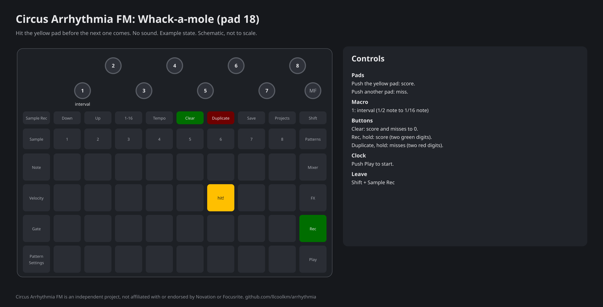

Hit the yellow pad before the next target comes on. Whack-a-mole makes no sound.

* **Clock.** Push Play to start. A new yellow pad comes on at each interval. Two sequential targets are never the
  same pad.
* **Pads.** Push the yellow pad to score. Each target scores once. While a target is active, a push on another pad
  counts a miss. After a hit, pad pushes are ignored until the next target. A target that you do not hit counts a
  miss when the next one comes.
* **Macro 1:** interval: a half note, a quarter note (start value), an eighth note or a sixteenth note. Clockwise is
  faster.
* **Clear** sets the score and the misses to 0. It also removes the target, without a miss.
* **Rec.** Hold Rec to see the score as two green digits.
* **Duplicate.** Hold Duplicate to see the misses as two red digits.
* While you hold Rec or Duplicate, the target does not show.
* Clear and Rec are lit green, Duplicate is lit red.
* The counts stop at 99.
* Start and stop remove the target without a miss.
