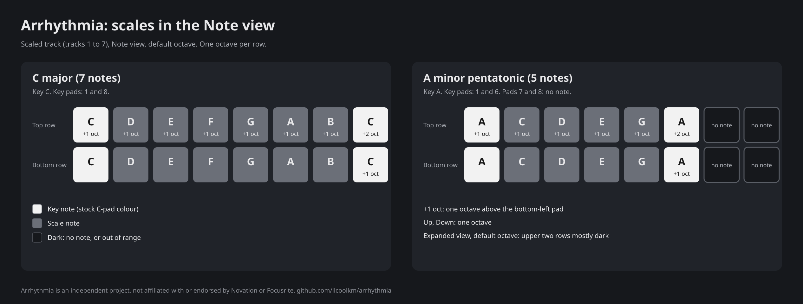

# Arrhythmia: scales on tracks 1 to 7

Applies to Arrhythmia 0.2: arrhythmia-firmware build 7323 and arrhythmia-devkit build 7228. Test status:
see the [release notes](../../RELEASE-NOTES-0.2.0.md). **TBD** items are not confirmed.

Scales are in both images. In arrhythmia-firmware (build 7323), set them on the synth page. In
arrhythmia-devkit (build 7228), set them over SysEx only.

## What it is

With scales on, a sample track plays its **Note view** in a musical scale instead of the chromatic keyboard, so every
pad you press is in key. Every pad that plays, plays a note of the scale. Each row of pads is one octave, from the key
note to the key note above it, and every pad you play lights itself. In 5- and 6-note scales the pads past the upper
key note are dark and silent. See [Range](#range-dark-pads) for pads that are out of the unit's range.

* **Tracks 1 to 7**, the sample tracks. You turn scales on or off for each of them.
* **One scale and one key for the whole project.** Every scaled track uses them. In arrhythmia-firmware the chords of
  track 8 follow the same scale and key (see [synth.md](synth.md)); track 8's own keyboard does not change.
* **Saved with the project.** The scale, the key and which tracks are scaled are stored in the project. A project
  made without scales opens with scales off.
* **On stock firmware**, a project with scales loads normally and its tracks play the normal chromatic Note view.
  **TBD:** not tested on hardware.

## Turn scales on for a track (arrhythmia-firmware)

1. Press **Shift + Track 8** to open the synth page.
2. Press **Track 1** to **Track 7** to turn scales on or off for that track. A scaled track has a bright green
   button; the others are dim.
3. Press **Shift + Track 8** again to close the page.

The synth page itself is described in [synth.md](synth.md#the-synth-page-shift--track-8).

## Choose the scale and the key (arrhythmia-firmware)

With the synth page open:

* Hold **Shift**. The top two rows show ten violet pads, one per scale; the bright one is the scale in use. Top row,
  from the left: major, natural minor, dorian, phrygian, lydian, mixolydian, harmonic minor, major pentatonic. Second
  row, first two pads: minor pentatonic, blues.
* Still holding **Shift**, press a key on the keyboard in the bottom two rows to set the key (C to B). The key in use
  is lit yellow.
* Without Shift, the last pad of the second row switches between natural minor and major.

## Choose the scale and the key (arrhythmia-devkit)

arrhythmia-devkit has no synth page. There, scale, key and tracks are set together over SysEx:

    F0 00 20 29 00 60 0E 01 <scale> <key> <tracks> F7

* `<scale>`: 0 to 9, in the order of the table below (0 major ... 9 blues).
* `<key>`: 0 to 11 (0 = C, 1 = C#, ... 11 = B).
* `<tracks>`: one bit per track: 1 = track 1, 2 = track 2, 4 = track 3 ... 64 = track 7; `7F` = all seven, `00` = none.

`F0 00 20 29 00 60 0E 00 F7` reports the current setting. The reply format is in
[../dev/devkit-sysex.md](../dev/devkit-sysex.md). This command works on arrhythmia-firmware too.

## The ten scales

Intervals are semitones above the key note. Notes are shown in the key of C.

| No. | Scale | Notes per octave | Intervals | In C |
|---|---|---|---|---|
| 0 | Major | 7 | 0 2 4 5 7 9 11 | C D E F G A B |
| 1 | Natural minor | 7 | 0 2 3 5 7 8 10 | C D Eb F G Ab Bb |
| 2 | Dorian | 7 | 0 2 3 5 7 9 10 | C D Eb F G A Bb |
| 3 | Phrygian | 7 | 0 1 3 5 7 8 10 | C Db Eb F G Ab Bb |
| 4 | Lydian | 7 | 0 2 4 6 7 9 11 | C D E F# G A B |
| 5 | Mixolydian | 7 | 0 2 4 5 7 9 10 | C D E F G A Bb |
| 6 | Harmonic minor | 7 | 0 2 3 5 7 8 11 | C D Eb F G Ab B |
| 7 | Major pentatonic | 5 | 0 2 4 7 9 | C D E G A |
| 8 | Minor pentatonic | 5 | 0 3 5 7 10 | C Eb F G Bb |
| 9 | Blues | 6 | 0 3 5 6 7 10 | C Eb F F# G Bb |

## Play: the Note view of a scaled track

Select a scaled track and press **Note**. The keyboard is the bottom two pad rows, 8 pads each. Each row is one
octave of the scale, from the key note up to the key note an octave higher:

* **Bottom row:** the scale from the key note up, ending on the key note an octave higher. In a 7-note scale that
  fills all 8 pads. In a 5-note scale (the pentatonics) it fills 6 pads and the last 2 are dark and silent; in blues
  (6 notes) it fills 7 pads and the last one is dark.
* **Top row:** the same as the bottom row, one octave higher. Its first pad is the same note as the last key-note pad
  of the bottom row.
* **Key pads:** every pad that plays the key note is highlighted, in the colour the stock Note view gives its C pads.
  In a 7-note scale these are pads 1 and 8 of each row; in a pentatonic scale pads 1 and 6; in blues pads 1 and 7.
  Only key notes sit on two pads, and both light together when that note plays.
* **Lights:** a pad you press lights itself, and so does the pad of a note the sequencer plays.
* **Up and Down** move the rows by one octave, as on stock firmware.
* **Expanded view** (press **Note** again, all four rows): four octaves, one per row, the lowest at the bottom. At the
  default octave the two upper rows run above the unit's highest note and are mostly dark; press **Down** twice for
  four full rows. See [Range: dark pads](#range-dark-pads).

At the default octave the bottom-left pad plays the key note in the octave where the stock Note view has its
bottom-left C (for example C in C, A above that C in A).

**Worked example: C major**

| Row | Pads 1 to 8 |
|---|---|
| Top | C D E F G A B C (one octave up) |
| Bottom | C D E F G A B C |

Key pads: 1 and 8 in both rows. The top-left C and the bottom-right C are the same note. All 16 pads play.

**Worked example: A minor pentatonic, default octave**

| Row | Pads 1 to 8 |
|---|---|
| Top | A C D E G A, then pads 7 and 8 dark (one octave up) |
| Bottom | A C D E G A, then pads 7 and 8 dark |

Key pads: 1 and 6 in both rows. The top-left A and bottom pad 6 are the same note. Pads 7 and 8 of each row have no
note: they are dark and silent in every key and at every octave.

### Range: dark pads

The Note view plays notes from the C# just under four octaves below the default bottom-left C up to the C three
octaves above it. A pad whose note falls outside that range is dark and silent. This is separate from the dark pads
past the upper key note of a 5- or 6-note scale (above), which never play.

**Simple view (two rows).** At the default octave and at every octave below it, every pad of every scale in every key
is in range. After one press of **Up**, 110 of the 120 scale and key combinations have dark pads at the top right
(only key C stays fully lit); after two presses every combination has them.

**Expanded view (four rows).** At the default octave the two rows above the simple view's rows start at the key note
two and three octaves above the bottom-left pad, and the top of the range cuts them off:

| Row | At the default octave |
|---|---|
| Top (pads 1 to 8) | Dark in every scale and key, except key C: its first pad plays the highest C, the rest is dark. |
| Second (pads 9 to 16) | Key C: all pads play (6 in a pentatonic scale, 7 in blues). Higher keys: fewer pads play, down to 1 or 2 in key B. A minor pentatonic: A and C play, the next four pads are dark. |
| Third and bottom | The simple view's two rows: every pad plays. |

Press **Down** once: key C (every scale) shows four full rows; the other keys still have dark pads at the top right.
Press **Down** twice: every scale in every key shows four full rows, and so does the lowest octave (one more press).

## Good to know

* What you record is what you heard: the pattern keeps the notes you played. Changing the scale or the key later does
  not change recorded notes.
* Holding a step and pressing a pad in the Note view puts that pad's note in the step, as usual.
* A pad you hold while the scale or key changes stops the note it started when you let go; nothing hangs.
* Sample view pads, MIDI notes coming in, and the sequencer are not changed by scales.
* A track whose sample is sliced keeps its slices in the Note view, even with scales turned on. Scales come back when
  slicing is turned off.
* If the page blinks red, the unit was busy (for example saving) and nothing changed. Wait a moment and press again.
* Only the key note sits on two pads (the end of one row and the start of the next); both light together while it
  plays.
* After a change of scale or key, the scaled tracks switch over one at a time, within a few moments.
* Changing a scale while the sequencer plays can lengthen the intervals of the MIDI clock the unit sends. At 130 BPM,
  with all seven tracks scaled, the longest clock interval measured during scale changes was 26.9 ms, against 24.0 ms
  without changes (measured on a development build). Devices that follow the unit's clock may notice it. This is
  a known limitation of 0.1.

## Evidence

* **On hardware (build 7229, the arrhythmia-firmware image of 0.1.0, 2026-10-20, one unit):** C major in the simple
  and expanded views (every pad lights itself), A minor pentatonic (the two dark pads per row), a note held across a
  scale change, scales off (the stock keyboard comes back), save and power cycle, and track 8 and unscaled tracks
  unaffected: all passed. Build 7261 (0.1.1) uses the same scales code for tracks 1 to 7. The scales tests in this
  list ran on the builds named, not on 7261.
* **On hardware (development build 7222, with a different keyboard layout):** a D harmonic minor setting persisted through save and power
  cycle, and the MIDI clock timing above was measured on the unit.
* **In emulation (builds 7228 and 7229, the images of 0.1.0):** the full layout for all ten scales in all twelve keys
  and every octave, both views, Up and Down, the key-pad colours, every pressed pad lighting itself (and notes played
  by the sequencer), and slice layouts staying unchanged.
* **Not tested on hardware:** arrhythmia-devkit 7228, the key-pad colours as such, slice layouts on a scaled track, and loading a project with
  scales on stock firmware.

Developer details: [../dev/design/scales.md](../dev/design/scales.md).
