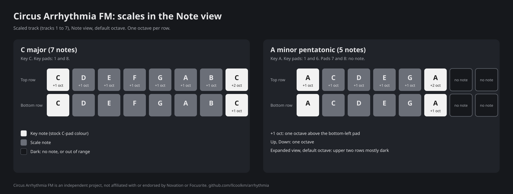

# Circus Arrhythmia FM: scales on tracks 1 to 7

Applies to Circus Arrhythmia FM 0.2.2, firmware build 7339 (arrhythmia-devkit build 7228, unchanged from 0.1.0).
Test status: see the [release notes](../../RELEASE-NOTES-0.2.2.md#test-status) and the
[0.1.0 release notes](../../RELEASE-NOTES-0.1.0.md).

Scales are in both images. In arrhythmia-firmware (build 7339), set them on the synth page. In
arrhythmia-devkit (build 7228), set them over SysEx only.

## What it is

With scales on, the **Note view** of a sample track plays a musical scale instead of the chromatic keyboard. All
pads that play are in key. Each pad row is one octave, from the key note to the key note above it. Each played pad
lights. In 5-note and 6-note scales, the pads past the upper key note are dark and silent. For pads out of the range
of the unit, refer to [Range](#range-dark-pads).

* **Tracks 1 to 7**, the sample tracks. Scales are on or off per track.
* **One scale and one key per project.** All scaled tracks use them. In arrhythmia-firmware, the chords of track 8
  use the same scale and key ([synth.md](synth.md)). The keyboard of track 8 does not change.
* **Saved with the project.** The project stores the scale, the key and the scaled tracks. A project without scales
  opens with scales off.

## Turn scales on for a track (arrhythmia-firmware)

1. Press **Shift + Track 8** to open the synth page.
2. Press **Down** to show page 2 (scale).
3. Press pad 1 to 7 of the top row to turn scales on or off for track 1 to 7. Each pad is below its track button.
   A scaled track has a bright green pad. The other pads are dim. Pad 8 of the row has no function.
4. Press a view or track button to close the page.

On the synth page, Track 1 to 7 do not turn scales on or off. They close the page and select that track.

The synth page: [synth.md](synth.md#the-synth-page).

## Choose the scale and the key (arrhythmia-firmware)

1. Open the synth page (**Shift + Track 8**).
2. Press **Down** to show page 2 (scale).
3. Press a pad in the second row to select a scale. The row has eight violet pads, one per scale. The bright pad is
   the scale in use. From the left: major, natural minor, dorian, mixolydian, harmonic minor, major pentatonic,
   minor pentatonic, blues.
4. Press a key on the bottom two rows (a keyboard, C to B) to set the key. The key in use is yellow.

* On page 1 of the synth page, the last pad of the second row switches between natural minor and major.
* arrhythmia-firmware has no Phrygian and no Lydian. A project that has Phrygian plays and shows natural minor. A
  project that has Lydian plays and shows major. The project keeps its stored value.

## Choose the scale and the key (arrhythmia-devkit)

arrhythmia-devkit has no synth page. One SysEx command sets scale, key and tracks. arrhythmia-devkit has all ten
scales of the table below:

    F0 00 20 29 00 60 0E 01 <scale> <key> <tracks> F7

* `<scale>`: 0 to 9, in the order of the table below (0 major ... 9 blues). arrhythmia-firmware refuses 3
  (Phrygian) and 4 (Lydian). Its reply gives 1 for a stored 3 and 0 for a stored 4.
* `<key>`: 0 to 11 (0 = C, 1 = C#, ... 11 = B).
* `<tracks>`: one bit per track: 1 = track 1, 2 = track 2, 4 = track 3 ... 64 = track 7; `7F` = all seven, `00` = none.

`F0 00 20 29 00 60 0E 00 F7` reports the current setting, also on arrhythmia-firmware. The reply format is in
[../dev/devkit-sysex.md](../dev/devkit-sysex.md).

## The scales

Intervals are semitones above the key note. The notes are in the key of C. arrhythmia-firmware has the eight
scales with a pad number. arrhythmia-devkit has all ten.

| No. | Pad (page 2, second row) | Scale | Notes per octave | Intervals | In C |
|---|---|---|---|---|---|
| 0 | 1 | Major | 7 | 0 2 4 5 7 9 11 | C D E F G A B |
| 1 | 2 | Natural minor | 7 | 0 2 3 5 7 8 10 | C D Eb F G Ab Bb |
| 2 | 3 | Dorian | 7 | 0 2 3 5 7 9 10 | C D Eb F G A Bb |
| 3 | none (devkit only) | Phrygian | 7 | 0 1 3 5 7 8 10 | C Db Eb F G Ab Bb |
| 4 | none (devkit only) | Lydian | 7 | 0 2 4 6 7 9 11 | C D E F# G A B |
| 5 | 4 | Mixolydian | 7 | 0 2 4 5 7 9 10 | C D E F G A Bb |
| 6 | 5 | Harmonic minor | 7 | 0 2 3 5 7 8 11 | C D Eb F G Ab B |
| 7 | 6 | Major pentatonic | 5 | 0 2 4 7 9 | C D E G A |
| 8 | 7 | Minor pentatonic | 5 | 0 3 5 7 10 | C Eb F G Bb |
| 9 | 8 | Blues | 6 | 0 3 5 6 7 10 | C Eb F F# G Bb |

## Play: the Note view of a scaled track

Select a scaled track and press **Note**.

The keyboard is the bottom two pad rows, 8 pads each. Each row is one
octave of the scale, from the key note to the key note one octave higher.

* **Bottom row:** the scale from the key note up to the key note one octave higher. A 7-note scale fills all 8 pads.
  A 5-note scale (the pentatonics) fills 6 pads, and the last 2 pads are dark and silent. Blues (6 notes) fills 7
  pads, and the last pad is dark.
* **Top row:** the bottom row, one octave higher. Its first pad has the same note as the last key-note pad of the
  bottom row.
* **Key pads:** all pads that play the key note have the colour of the C pads in the stock Note view. In a 7-note
  scale, these are pads 1 and 8 of each row. In a pentatonic scale, pads 1 and 6. In blues, pads 1 and 7. Only key
  notes are on two pads. Both pads light together when that note plays.
* **Lights:** a pressed pad lights. The pad of a note that the sequencer plays also lights.
* **Up and Down** move the rows by one octave, as on the stock firmware.
* **Expanded view** (press **Note** again, all four rows): four octaves, one per row, the lowest at the bottom. At
  the default octave, the two upper rows are above the highest note of the unit and are mostly dark. Press **Down**
  two times for four full rows. Refer to [Range: dark pads](#range-dark-pads).

At the default octave, the bottom-left pad plays the key note in the octave of the bottom-left C of the stock Note
view (for example C in C, A above that C in A).

**Example: C major**

| Row | Pads 1 to 8 |
|---|---|
| Top | C D E F G A B C (one octave up) |
| Bottom | C D E F G A B C |

Key pads: 1 and 8 in both rows. The top-left C and the bottom-right C are the same note. All 16 pads play.

**Example: A minor pentatonic, default octave**

| Row | Pads 1 to 8 |
|---|---|
| Top | A C D E G A, then pads 7 and 8 dark (one octave up) |
| Bottom | A C D E G A, then pads 7 and 8 dark |

Key pads: 1 and 6 in both rows. The top-left A and bottom pad 6 are the same note. Pads 7 and 8 of each row have no
note. They are dark and silent in all keys and at all octaves.

### Range: dark pads

The Note view plays notes from the C# 47 semitones below the default bottom-left C, up to the C three octaves
above it. A pad with a note outside this range is dark and silent. These pads are different from the dark
pads past the upper key note of a 5-note or 6-note scale, which never play.

**Simple view (two rows).** At the default octave and at all lower octaves, all pads of all scales in all keys are
in range. After one press of **Up**, 110 of the 120 scale and key combinations have dark pads at the top right. Only
key C stays fully lit. After two presses, all combinations have dark pads.

**Expanded view (four rows).** At the default octave, the two upper rows start at the key note two and three
octaves above the bottom-left pad. The top of the range cuts them off:

| Row | At the default octave |
|---|---|
| Top (pads 1 to 8) | Dark in all scales and keys, except key C: its first pad plays the highest C, the other pads are dark. |
| Second (pads 9 to 16) | Key C: all pads play (6 in a pentatonic scale, 7 in blues). Higher keys: fewer pads play, down to 1 or 2 in key B. A minor pentatonic: A and C play, the next four pads are dark. |
| Third and bottom | The two rows of the simple view: all pads play. |

* Press **Down** one time: key C (all scales) shows four full rows. The other keys still have dark pads at the top
  right.
* Press **Down** two times: all scales in all keys show four full rows. The lowest octave (one more press) also
  shows four full rows.

## Behaviour

* The pattern keeps the played notes. A later change of the scale or the key does not change recorded notes.
* Hold a step and press a pad in the Note view to put the note of that pad in the step.
* A pad held during a scale or key change stops its note when you release it. No note hangs.
* Scales do not change Sample view pads, incoming MIDI notes or the sequencer.
* A track with a sliced sample keeps its slices in the Note view when scales are on. Scales come back when slicing
  is off.
* If the page blinks red, the unit was busy (for example saving) and nothing changed. Wait and press again.
* After a change of scale or key, the scaled tracks change one at a time, within a few moments.
* A scale change while the sequencer plays can lengthen the intervals of the MIDI clock that the unit sends. Devices
  that follow the clock of the unit can be affected. Measured at 130 BPM with all seven tracks scaled:

| Condition | Longest clock interval |
|---|---|
| No scale changes | 24.0 ms |
| During scale changes | 26.9 ms |

Developer details: [../dev/design/scales.md](../dev/design/scales.md).
