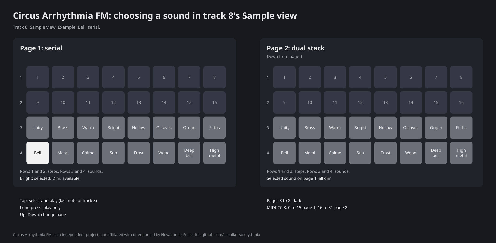
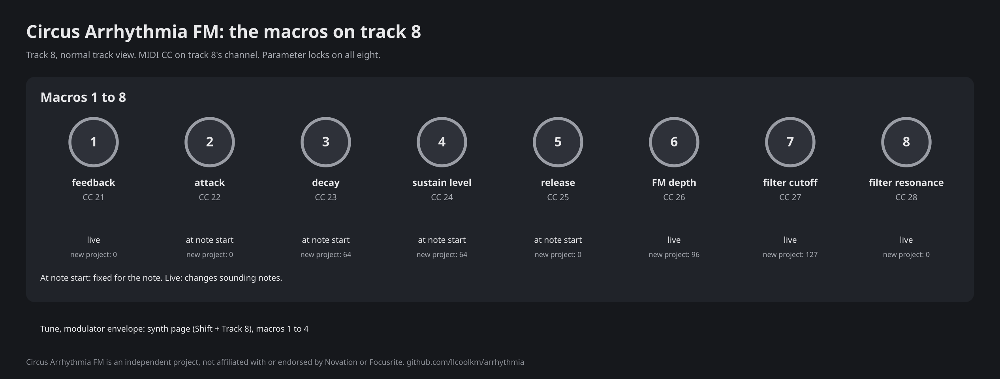
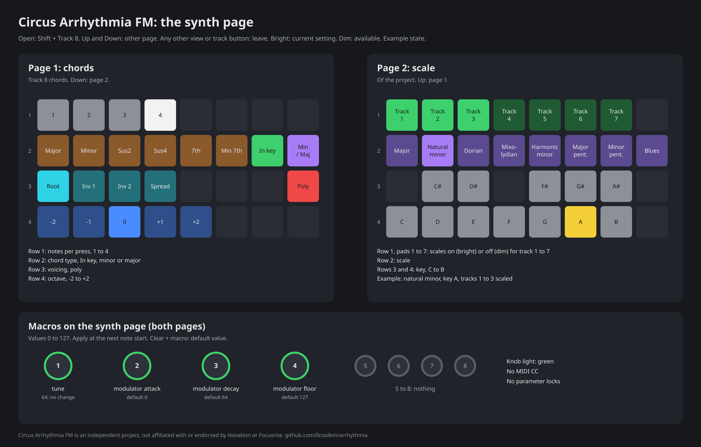
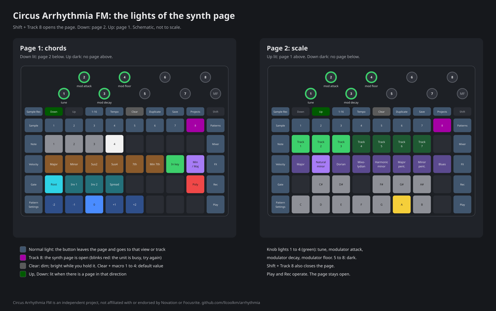
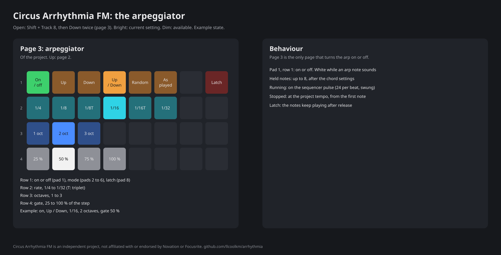

# Circus Arrhythmia FM: the track 8 FM synth

Applies to Circus Arrhythmia FM 0.3.1, firmware build 7388, with the FM engine 2.0.0. Test status and known
limitations: see the [release notes](../../RELEASE-NOTES-0.3.1.md).

* Track 8 plays either its samples or an engine. The pack chooses ([Engines on track 8](#engines-on-track-8)).
  Tracks 1 to 7 are sample tracks.
* The FM engine is designed as a 4-operator FM synth with 4 voices. A note that fades out after its release occupies a voice.
* Note sources: pads (track 8 selected), sequencer, MIDI on the channel of track 8 (default 8), modules.
* The synth output passes through the mixer channel of track 8: level, pan, sends and FX apply.
* The sections after Engines describe track 8 with the FM engine.

## Engines on track 8

An engine is a file on the microSD card. Each pack selects the engine of track 8, or none. The selection applies
when the pack loads: at power-on and at a pack change. The firmware contains no engine. Without an engine, track 8
plays the samples of the pack.

**Upgrading from 0.3.0:** firmware 0.3.1 refuses `fm.dse` 1.0.0. Install `fm.dse` 2.0.0. Until then, every pack that
selects FM plays samples. Pack selections stay valid.

**Upgrading from 0.2.2:** the firmware no longer contains the FM synth. Until you add and select `fm.dse`, track 8
plays samples, including in existing synth projects. The factory pack needs `engines/default.cfg`.

Get the FM engine file `fm.dse` from the release page: <https://github.com/llcoolkm/arrhythmia/releases>.

| Path on the card | Content |
|---|---|
| `engines/fm.dse` | The FM engine file. |
| `Rhythm/NN_<Name>/engine.cfg` | The pack's selection: one line, `fm.dse` or `none`. |
| `engines/default.cfg` | The selection for packs without `engine.cfg` and for the factory pack. Same format. |

Use lowercase for Arrhythmia's own paths and selection text. Engine names and `none` accept any case; existing
uppercase names on FAT cards remain compatible. Keep the stock pack folder convention `Rhythm/NN_<Name>`.

### Select the FM engine over USB

Open the [loader](https://llcoolkm.github.io/arrhythmia/web/loader.html) in Chrome. The firmware installer is a
[separate page](https://llcoolkm.github.io/arrhythmia/web/).

1. Connect the unit by USB, stop playback and close other MIDI applications. Select **Connect MIDI**.
2. Under **Engines**, use **Scan card** to read the engine files and pack selections from the card.
3. Add the published `fm.dse`, or update an existing copy. This writes `engines/fm.dse`.
4. Select a pack row returned by the unit, choose **FM** and press **Save choice**. Choose **Samples** for `none`.
5. Load the pack on the unit in the stock **Packs** view. Save any project edits first: a pack load discards unsaved edits.

A selection change takes effect at the next pack load. The loader does not load packs. It shows the actual card
folder names reported by the unit. Unknown, ambiguous or incomplete rows cannot be selected; do not infer a pad
number or the factory pack from a raw selector. Some non-ASCII folder names appear as short FAT aliases, flagged
by the loader.

**Scan card** and **Check status** only read. Adding, updating or removing an engine changes the card. Removing an
engine keeps pack selections intact; packs still naming the removed file play samples on their next load.
Changing the default can affect every pack without its own selection, as well as the factory pack.

The FM engine has its own version, **2.0.0**, independent of firmware **0.3.1**. In the reference scenes in the
emulator, its output is word for word the output of 1.0.0. The loader shows engine names and versions read from the
card. A different checksum does not prove that a file is older. Before a load, the firmware applies the checks of engine
ABI 3 ([checks](engines-dev.md#checks)). A version number alone does not establish compatibility. The interface is
written in [engines for developers](engines-dev.md). Engines from other authors load if they pass the checks.

### Select the FM engine with a card reader

1. Turn the unit off and remove the card. Make a backup first ([install.md](install.md#back-up-first)).
2. Put the card in a card reader. Make the folder `engines` at the root of the card.
3. Copy `fm.dse` into `engines`.
4. Open the folder of the pack inside `Rhythm`. The folder name starts with two digits, for example `05_mypack`.
5. Make a text file `engine.cfg` in that folder. Its content is one line: `fm.dse`.
6. Put the card back and turn the unit on.
7. Load the pack. The pack that is current at power-on loads at power-on. Select any other pack in the Packs view.
8. Select track 8 and play a pad. The FM synth sounds.

### Select the FM engine for all packs without a selection

1. Do steps 1 to 3 above.
2. Make a text file `default.cfg` in `engines`. Its content is one line: `fm.dse`.
3. Put the card back and turn the unit on. Load the packs as in step 7 above.

A pack with its own `engine.cfg` ignores `default.cfg`. The factory pack has no folder on the card. It uses
`default.cfg` only.

### Return a pack to samples

1. Open the pack folder on the card in a card reader.
2. Change the content of `engine.cfg` to one line: `none`.
3. Put the card back and load the pack.

* With `none`, the pack plays samples even when `default.cfg` names an engine.
* Deleting `engine.cfg` gives the selection of `default.cfg`. Without `default.cfg`, the pack plays samples.
* For packs without their own selection and the factory pack, delete `default.cfg` or change it to `none`.
  Packs with their own `engine.cfg` keep that selection.

### What the unit does

| Card state | Track 8 |
|---|---|
| `engine.cfg` names an engine file that is present and valid | The engine. |
| `engine.cfg` says `none` | Samples. |
| No `engine.cfg`, `default.cfg` names an engine file that is present and valid | The engine. |
| No `engine.cfg` and no `default.cfg` | Samples. |
| `engine.cfg` or `default.cfg` is not valid | Samples. |
| The named file is missing, damaged or not an engine file | Samples. |
| The named file is for the interface of 0.3.0, such as `fm.dse` 1.0.0, or fails a check of engine ABI 3 | Samples. `card engstatus` shows the reason. |

* A valid selection is one line: a name of 1 to 8 characters (A to Z, 0 to 9, `_`, `-`, any case) followed by
  `.dse`, or `none`. A line break at the end is allowed. The file is at most 32 bytes.
* `default` is reserved. No engine file has this name.
* A failed selection never falls back to the default or to another engine. The pack plays samples.
* A project change inside a pack keeps the engine. A pack change loads the engine selected by the new pack.
* During a pack load, track 8 notes stop and new notes do not sound until the load ends.
* The loader or the host tool writes the selection over USB ([developers.md](developers.md#engines-over-usb)).
  Load the pack on the unit in the stock Packs view.

### Track 8 without an engine

* Track 8 is a sample track as tracks 1 to 7: the Sample view with its eight pages, the stock macros and the stock
  Note view.
* Shift + Track 8 opens the scale page only ([The synth page](#the-synth-page)). Up, Down and the macros of the page
  have no function. The chord and arp pages are not available.

### Engines from other authors

* The firmware loads any engine file that passes its checks. Passing the checks does not prove that an engine is
  safe or that it sounds right.
* An engine runs with full access to the sound processor of track 8. A faulty engine can stop it. Rec then blinks
  white, and only a power cycle recovers the unit.
* If Rec blinks white soon after you chose an engine:
  1. Save the project.
  2. Set the pack to Samples with the loader.
  3. Turn the unit off and on.
* Without step 2, the same engine loads again at power-on.

## Choosing a sound: the Sample view

With the FM engine.

1. Select track 8.
2. Open the Sample view.
3. Tap a pad in row 3 or 4. The tap selects the sound and plays it.

* The view opens on the page of the selected sound. For a sound of 32 or more (CC 8), it opens on the first page.
* The view has two pages. Down shows the second page. Up shows the first page. The Down light is off on the second
  page. Tracks 1 to 7 keep the stock pages. Track 8 without an engine keeps them too.
* A new sound applies from the next note. Feedback, modulator envelope and FM depth do not change.
* At low FM depth, the families sound almost the same. Increase macro 6.
* Sound per step: hold a sound pad and tap a step, or the reverse. A recorded sound pad press also stores the sound.
* CC 8 values 32 to 127 select Unity, serial.

## Macros on track 8

Select track 8. The macro knobs then control the synth.

The ranges are design values. They are not measured on the unit.

| Macro | Range |
|---|---|
| 1 feedback | 0 to 127, up to a feedback gain of 8x; audible only with FM depth (macro 6) above 0 |
| 2 attack | approx. 10 ms to 8 s |
| 3 decay | T60 50 ms to 8 s |
| 4 sustain level | linear, 0 = silent, 127 = full |
| 5 release | T60 approx. 29 ms to 8 s, smooth start |
| 6 FM depth | 0 = no FM; new projects 96 |
| 7 filter cutoff | 0 to 127 (refer to Filter below) |
| 8 resonance | 0 to 127 (refer to Filter below) |

* MIDI CC 21 to 28 and parameter locks operate on all eight macros.
* Macro 1 (feedback) and macros 6 to 8 apply immediately, also to sounding notes. A parameter lock or a restore of
  macro 1 also applies immediately.
* Macros 2 to 5 apply at note start. A knob turn changes the next notes, not the sounding notes.
* Macro 1 applies immediately with the `fm.dse` of this release. An older development `fm.dse` applies macro 1 at
  note start.
* A step without a lock uses the knob value. A lock on macro 1 sets the feedback of that step.
* The lights of macro 1 (feedback) and macro 4 (sustain) go from off to full.
* T60 is the time to decrease by 60 dB. It is not the time to silence.
* Clear + macro 1 sets feedback 0. Clear + macro 6 sets FM depth 96.
* Clear + macro 3 sets decay 64. In lock edit (Rec held with a step), it records 127, as on stock.
* Shift + macro 2 or 3 (CC 86, CC 87) has no effect.
* Filter: quiet signals keep approximately the same low-frequency level at all resonance values.
* Filter: the top of the cutoff range is smooth. Strong resonant peaks are shaped to limit their level. This shaping
  changes their tone.

## Output level

* The synth output is decreased by a fixed **4 dB**, before the level, pan, sends and FX of track 8.
* No setting changes this value.
* Set the balance with the mixer level of track 8. A higher level increases the risk of crackle on loud chords.

## The synth page

Open the synth page with **Shift + Track 8**. Without the FM engine on track 8, only the scale page opens
([Track 8 without an engine](#track-8-without-an-engine)).

| Page | Pads |
|---|---|
| 1 chords | notes per press, chord type, In key, minor or major, voicing, poly, octave; row 1 pad 8 is dark and has no function |
| 2 scale | row 1, pads 1 to 8: scales on or off for track 1 to 8; row 2: scale (eight scales); rows 3 and 4: key, C to B ([scales.md](scales.md)) |
| 3 arp | on or off, mode, latch, rate, octaves, gate ([The arpeggiator](#the-arpeggiator)) |

* **Down** shows the next page. **Up** shows the previous page. The Up or Down light is on when there is a page in
  that direction.
* The synth page opens on the last page used. After a power cycle, it opens on page 1.
* A view or track button (for example Note, Sample, Velocity, Gate, Mixer, Track 1 to 8) closes the page. The unit
  goes to that view or track, as from any other view. The button press is not lost.
* Note goes to the Note view in its last layout (normal or expanded). It does not switch between the layouts.
* Shift + Track 8 also closes the page.
* Play and Rec operate while the page is open. The page stays open.
* Shift has no function on the page. Shift + pad does the same as the pad.

Lights while the page is open:

* The view and track buttons keep their normal lights. Track 8 is magenta.
* Up or Down is green when there is a page in that direction.
* Shift keeps its normal light.
* Clear keeps its normal light (dim red when that light is off). Clear is red while you hold it.

| Synth page macro (page 1 only) | New project and Clear + macro |
|---|---|
| 1 tune (64: no change; 5 steps per semitone, plus or minus 12 semitones) | 64 |
| 2 modulator attack (same range as attack) | 0 |
| 3 modulator decay | 64 |
| 4 modulator floor (modulation level after its decay) | 127 |

* Macros 1 to 4 apply at the next note start. They do not change sounding notes.
* **Clear + macro** sets that macro to the value in the table. Hold Clear and turn the knob.
* Macros 1 to 4 act on page 1 only. On pages 2 and 3 the knobs have no function, their lights are dark and
  Clear + macro does nothing.
* Macros 5 to 8 have no function on the page.
* The light of macro 1 (tune) has its centre at 64.
* The project saves the values.
* **Save** closes the page and starts the save, as from any other view. A knob turn immediately before the save is saved.
* When the unit is busy, the Track 8 light blinks red and the page ignores the edit. Do the edit again.
* The page does not open while a module runs. Shift + Sample Rec on the page closes the page and opens the module
  picker.

## The arpeggiator

Open the synth page with **Shift + Track 8**, then use **Up** or **Down** to reach page 3. Only page 3 turns the arp
on or off. The synth page opens on the last page used.

| Row | Pads | Setting | New project |
|---|---|---|---|
| 1 | 1 | arp on or off (green) | off |
| 1 | 2 to 6 | mode: Up, Down, Up / Down, Random, As played (orange) | Up |
| 1 | 8 | latch (red) | off |
| 2 | 1 to 6 | rate: 1/4, 1/8, 1/8T, 1/16, 1/16T, 1/32 (cyan) | 1/16 |
| 3 | 1 to 3 | octaves: 1, 2, 3 (blue) | 1 |
| 4 | 1 to 4 | gate: 25, 50, 75, 100 % of the step (white) | 50 % |

* Bright is the current setting. Pad 1 is white while an arp note sounds.
* With the arp on, notes held on track 8 do not sound directly. The arp plays them one at a time.
* Notes come from pads, MIDI in on track 8's channel, modules and the sequencer. Chord settings apply first: a held
  pad with notes per press 3 gives the arp three notes. The arp holds up to 8 notes. A press whose notes do not all
  fit plays normally.
* Each source keeps its own notes. A note off removes only the notes of that press.
* Modes:

| Mode | Order |
|---|---|
| Up | lowest to highest, then again from the lowest |
| Down | highest to lowest, then again from the highest |
| Up / Down | up, then down; the highest and lowest notes play once per turn |
| Random | any held note in any octave of the range |
| As played | in the order the notes were pressed, then the same an octave higher |

* Octaves 2 and 3 repeat the held notes one and two octaves higher.
* While the sequencer runs, arp notes start on the sequencer's pulse (24 per beat) and follow its swing. Play
  restarts the pattern at the start of the bar. A note pressed while the sequencer runs starts at the next step.
* While the sequencer is stopped, the arp runs at the project tempo, without swing. The first note sounds at the
  press. A tempo change applies at once.
* Gate is the length of each arp note as a part of the step.
* Latch: the notes keep playing after release. The next press after all notes are up replaces them. A press while a
  note is held adds to them. Latch off and Stop remove the released notes.
* Poly on: each arp note rings out in its release while the next starts. Poly off: each arp note cuts the previous.
* While the arp is on, MIDI out on track 8's channel sends the arp notes. It does not send the held notes.
* Stop (press Play): notes from the sequencer leave the arp. Held pads and MIDI notes keep playing.
* Mute track 8: the arp is silent. Held and latched notes stay and play again after unmute.
* Choke and sample edit stop the arp note. The arp goes on at the next step.
* Project load and CC 123: the arp note stops and the arp lets go of all notes.
* Arp off: the arp note stops. Notes held while the arp turns off do not sound until pressed again.
* When the sequencer runs but its clock stops, the arp note stops after half a second.
* The project saves the settings. Each project has its own.
* When the unit is busy, the Track 8 light blinks red and the page ignores the edit. Do the edit again.

## Notes, chords and voices

| Notes per press | Pads | Sequencer | MIDI in |
|---|---|---|---|
| 1, poly on | held pads sound together, up to 4 | newest note wins | up to 4 notes |
| 1, poly off | newest note wins | newest note wins | newest note wins |
| 2 to 4 | chord; a new press replaces it | same as pads | chord; a new note replaces it |

* Chords: the pressed note is the root. In key uses the project scale and key, shared with tracks 1 to 7
  ([scales.md](scales.md)).
* Scales on for track 8 (page 2, row 1, pad 8): the Note view plays the project scale, as on tracks 1 to 7. MIDI in
  and recorded notes do not change.
* Design voice order (not measured on the unit) when all 4 voices are busy: free voice, voice released
  longest ago, voice held longest.
* Each press of the same note has its own voice. A note off releases the newest matching note from that source.
* With notes per press 2 to 4, a recorded chord stores its root note. Playback uses the current chord settings.
* With notes per press 1, pads or MIDI notes played together record as a step chord ([Step chords](#step-chords)).
* Track 8 ignores slice mode.
* Stop (press Play), CC 123 and mute: sounding notes go to their release. CC 120 has no effect, as on stock.
* Project load, pack load, choke and sample edit: sounding notes stop immediately. Choke groups operate on track 8.

## Step chords

A step of track 8 holds up to 4 notes. All notes of the step share its velocity, gate, probability, microsteps,
sound and locks.

Enter a chord in the Note view:

1. Hold the step.
2. Press a key. On an empty step, this key sets the root, as on stock.
3. Press more keys. Each key adds its note, up to 4. The step plays the chord.
4. Press a chord note again to remove it. Press the lowest note to remove the step. The step stays removed when you
   release it. A step with 1 note operates as on stock: when you release the step, it comes back as a new step.

* The lowest note is the root of the step. A new lower note becomes the root. The other notes stay.
* While you hold the step, the other notes of the chord show in a second colour.
* Notes more than 96 semitones above the lowest note are not added.

Record a chord:

1. Set notes per press to 1.
2. Start the recording.
3. Press 2 to 4 pads together, or send 2 to 4 MIDI notes together.

* Notes that start in the same step, or within 1 microstep of the first note, make one chord step.
* A note joins the chord only while another note of the chord is held.
* The gate runs from the first note to the release of the last released note.
* A new note while chord notes are held ends the gate of the chord at the new note.
* A project load, a recording stop, or notes per press 2 to 4 ends the chord in recording. The next note starts a
  new step.

Playback and storage:

* The stored notes play as stored. Notes per press, chord type and In key do not change them. Track octave applies.
* A step with 1 note uses the current chord settings.
* MIDI out sends the root only.
* A project holds up to 31 different chord shapes (the intervals above the root). When all 31 are in use, a new
  shape is not added. Remove chord steps that use other shapes first. Shapes that no step uses are reused.
* During a project save or load, a step does not change and a recording stores a single note.
* If the Arrhythmia data of the project is damaged or from a newer version, or its chord shapes are not valid,
  chord steps play only the root and do not change.
* The stock firmware plays only the root of a chord step. A stock save keeps the chords for Arrhythmia.

## Loading samples while the unit runs

The synth starts again automatically after a sample load.

| Event | Recovery |
|---|---|
| Pack change; sample transfer or load, including SysEx read-back | yes |
| Sample edit that transfers sample data | yes, same path |
| Other sample edits (preview, trim, start, end, tune, other parameters) | no; can stop sounding track 8 notes |
| Project change in the same pack | no; can stop sounding track 8 notes |
| Loading at startup | no |

* During the load, sounding track 8 notes stop and new track 8 notes do not sound.
* After the load, the synth uses the settings loaded at that time. After a pack change, these settings can be
  different.
* If the restart does not complete, track 8 stays silent. Save the project. Then turn the unit off and on.

## Saving and older projects

The project saves the synth settings, the selected sound, the sounds per step and the macros.

| Project | Opens with |
|---|---|
| New | Unity, serial; FM depth 96; other defaults as in the images |
| Stock or imported | its stored track 8 sample slot as sound; its macro values; feedback from its old Tune value |
| Arrhythmia 0.1.0 to 0.2.0 | stored slot as sound; macros; synth page; same sound (tune to the page, feedback to macro 1) |

* Slot 0 to 31 (counted from 0) selects that pad on page 1 or 2. Slot 32 or higher plays Unity, serial.
* In stock projects, macros 1 and 4 to 8 set synth values. Examine them. Macro 6 at 0 gives no FM depth.
* Stock or imported projects open with feedback from their old Tune value. Examine macro 1.
* Locks on macro 1 in older projects were tune locks. They set feedback.
* Arrhythmia 0.2.0 does not read the tune and feedback of a project saved by 0.2.1. It uses its defaults.
* Stored sample flips on track 8 select a sound per step (slot rules as above). Old patterns can sound different.
  Arrhythmia does not remove the flips.
* In a project never opened in Arrhythmia, track 8 length (macro 3) 127 opens as decay 64. Save to keep it.
* If Rec blinks white, the DSP does not answer. Save, then turn the unit off and on
  ([install.md](install.md#rec-blinks-white)).

## Known issues

Details: [0.3.1 known limitations](../../RELEASE-NOTES-0.3.1.md#known-limitations),
[0.3.0 known limitations](../../RELEASE-NOTES-0.3.0.md#known-limitations),
[0.2.2 known issues](../../RELEASE-NOTES-0.2.2.md#known-issues),
[0.2.1 known issues](../../RELEASE-NOTES-0.2.1.md#known-issues) and
[0.2.0 known issues](../../RELEASE-NOTES-0.2.0.md#known-issues).

* Some settings with high level or high resonance can crackle.
* On the test unit, one sample also crackles with the official firmware 5706.
* High notes lose the character of the family.
* A note released before its attack ends can produce a small tick.
* The end of a fading note has a small rounding artefact at a very low level.
