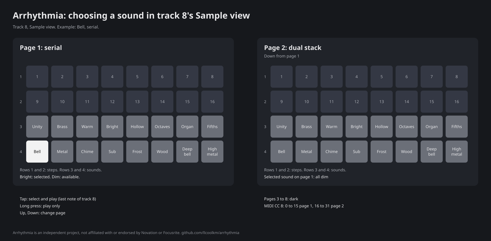
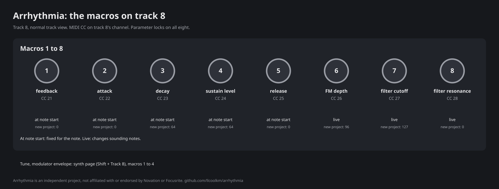
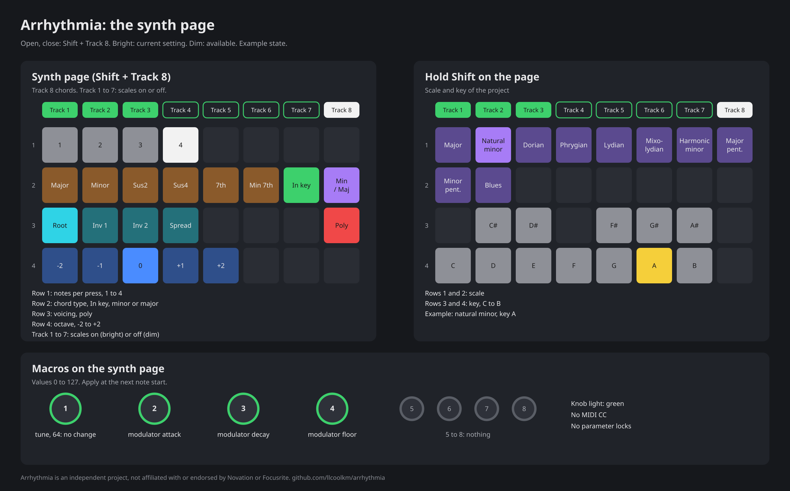

# Arrhythmia: the track 8 FM synth

Applies to Arrhythmia 0.2.1, arrhythmia-firmware build 7329. Test status and full known issues: see the
[release notes](../../RELEASE-NOTES-0.2.1.md).

* Track 8 is a 4-operator FM synth. It replaces the saw synth of 0.1.x. Tracks 1 to 7 are sample tracks.
* arrhythmia-devkit has no synth. Track 8 is a stock sample track there.
* The synth has 4 voices. Notes in their release use voices.
* Note sources: pads (track 8 selected), sequencer, MIDI on track 8's channel (default 8), modules.
* Track 8 keeps its stock mixer level, pan, sends and FX.

## Choosing a sound: the Sample view

1. Select track 8.
2. Open the Sample view.
3. Tap a pad in row 3 or 4. The tap selects the sound and plays it.

* The view opens on the page of the selected sound.
* A new sound applies from the next note. Feedback, modulator envelope and FM depth do not change.
* With low FM depth, the families sound almost the same. Increase macro 6.
* Per-step sound: hold a sound pad and tap a step, or the reverse. A recorded sound pad press also stores the sound.
* CC 8 values 32 to 127 select Unity, serial.

## Macros on track 8

| Macro | Range (design values, not measured on the unit) |
|---|---|
| 1 feedback | 0 to 127; audible only with FM depth (macro 6) above 0 |
| 2 attack | approx. 10 ms to 8 s |
| 3 decay | T60 50 ms to 8 s |
| 4 sustain level | linear, 0 = silent, 127 = full |
| 5 release | T60 approx. 29 ms to 8 s, smooth start |
| 6 FM depth | 0 = no FM; new projects 96 |
| 7 filter cutoff | 0 to 127 (see Filter below) |
| 8 resonance | 0 to 127 (see Filter below) |

* MIDI CC 21 to 28 and parameter locks operate on all eight macros.
* Macros 1 to 5 apply at note start. A knob turn changes the next notes, not the sounding ones. Macros 6 to 8 are
  live.
* The lights of macro 1 (feedback) and macro 4 (sustain) go from off to full.
* T60 is the time to decrease by 60 dB. It is not the time to silence.
* In 0.1.x, attack and decay changed sounding notes. In 0.2 they apply at note start.
* A step without a lock uses the knob value.
* Feedback (macro 1) applies at note start. A lock on macro 1 sets the feedback of that step.
* Clear + macro 1 sets feedback 0.
* Up to 0.2.0, macro 1 was tune. Tune is now on the synth page.
* Shift + macro 2 or 3 (CC 86, CC 87) has no effect.
* Clear + macro 3 sets decay 64. In lock edit (Rec held with a step), it records 127, as on stock.
* Clear + macro 6 sets FM depth 96.
* Filter: quiet signals keep approximately the same low-frequency level at all resonance values.
* Filter: the top of the cutoff range is smooth. Strong resonant peaks are shaped to limit their level. This can
  change their tone.

## Output level

* The synth output is decreased by a fixed **7 dB**, before track 8's mixer level, pan, sends and FX.
* No setting changes this value. Only this page gives the value.
* Set the balance with track 8's mixer level. A higher level increases the risk of crackle on loud chords.

Loudness test (one test only): a development build with output 2 dB lower than this release; the loaded project's
sound; median of seven samples played on the unit; loudness over 9.5 s. Results: single note approx. 3 dB quieter,
four-note chord approx. 3 dB louder, four-note chord with hot settings approx. 15 dB louder. Other conditions give
other results.

## The synth page: Shift + Track 8

| Synth page macro | New project |
|---|---|
| 1 tune (64: no change; 5 steps per semitone, plus or minus 12 semitones) | 64 |
| 2 modulator attack (same range as attack) | 0 |
| 3 modulator decay | 64 |
| 4 modulator floor (modulation level after its decay) | 127 |

* Macros 1 to 4 apply at the next note start. They do not change sounding notes.
* The light of macro 1 (tune) has its centre at 64.
* Up to 0.2.0, synth page macro 1 was feedback. Feedback is now macro 1 of the normal track view.
* The project saves the values.
* **Save does not operate while the synth page is open.** Close the page, then press Save.
* When the unit is busy, the page blinks red and ignores the edit. Try again.
* The page does not open while a module runs. Up and Down have no function on the page.

## Notes, chords and voices

| Notes per press | Pads | Sequencer | MIDI in |
|---|---|---|---|
| 1, poly on | held pads sound together, up to 4 | newest note wins | up to 4 notes |
| 1, poly off | newest note wins | newest note wins | newest note wins |
| 2 to 4 | chord; a new press replaces it | same as pads | chord; a new note replaces it |

* Chords: the pressed note is the root. In key uses the project scale and key, shared with tracks 1 to 7
  ([scales.md](scales.md)).
* Voice order when all 4 are busy: free voice, voice released longest ago, voice held longest.
* Each press of the same note has its own voice. A note off releases the newest matching note from that source.
* With notes per press 2 to 4, a recorded chord stores its root note. Playback uses the current chord settings.
* With notes per press 1, pads or MIDI notes played together record as a step chord ([Step chords](#step-chords)).
* Track 8 ignores slice mode, as in 0.1.1.
* Stop (press Play), CC 123 and mute: sounding notes go to their release. CC 120 has no effect, as on stock.
* Project load, pack load, choke and sample edit: sounding notes stop immediately. Choke groups operate on track 8.

## Step chords

A track 8 step can hold up to 4 notes. All notes of the step share its velocity, gate, probability, microsteps,
sound and locks.

Enter a chord in the Note view:

1. Hold the step.
2. Press a key. On an empty step, this key sets the root, as on stock.
3. Press more keys. Each key adds its note, up to 4. The step plays the chord.
4. Press a chord note again to remove it. Press the lowest note to remove the step. The step stays removed when you
   release it. (A step with only 1 note works as on stock: when you release the step, it comes back as a new step.)

* The lowest note is always the step's root. A new lower note becomes the root; the other notes stay.
* While you hold the step, the chord's other notes show in a second colour.
* Notes more than 96 semitones above the lowest note are not added.

Record a chord: set notes per press to 1. Press 2 to 4 pads (or send MIDI notes) together while recording. Notes
that start in the same step, or within 1 microstep of the first note, make one chord step. A note joins the chord
only while another note of the chord is held. The gate runs from the first note to the release of the last note
that you release. If you start a new note while chord notes are held, the chord's gate ends at the new note.

* A project load, a stop of the recording, or notes per press 2 to 4 ends the chord that is being recorded. The
  next note starts a new step.

* Playback: the stored notes play as they are. Notes per press, chord type and in key do not change them. Track
  octave applies.
* A step with 1 note uses the current chord settings, as before.
* MIDI out sends the root only.
* A project holds up to 31 different chord shapes (the intervals above the root). When all 31 are in use, a new
  shape is not added; remove chord steps that use other shapes first. Shapes that no step uses are reused.
* During a project save or load, a step does not change and a recording stores a single note.
* If the project's Arrhythmia data is damaged or from a newer version, or its chord shapes are not valid, chord
  steps play only the root and do not change.
* Stock firmware plays only the root of a chord step. A stock save keeps the chords for Arrhythmia.

## Loading samples while the unit runs

The synth starts again automatically after a sample load.

| Event | Recovery |
|---|---|
| Pack change; sample transfer or load, including SysEx read-back | yes |
| Sample edit that transfers sample data | yes, same path |
| Other sample edits (preview, trim, start, end, tune, other parameters) | no; can stop sounding track 8 notes |
| Project change in the same pack | no; can stop sounding track 8 notes |
| Loading at startup | no |

* During the load, sounding track 8 notes stop and new track 8 notes do not sound.
* After the load, the synth uses the settings loaded at that time. After a pack change, these can be different.
* If the restart does not complete, track 8 stays silent. Save the project. Then turn the unit off and on.

## Saving and older projects

The project saves the synth settings, the selected sound, the per-step sounds and the macros.

| Project | Opens with |
|---|---|
| New | Unity, serial; FM depth 96; other defaults as in the images |
| Stock or imported | its stored track 8 sample slot as sound; its macro values; feedback from its old Tune value |
| Arrhythmia 0.1.0 to 0.2.0 | stored slot as sound; macros; synth page; same sound (tune to the page, feedback to macro 1) |

* Slot 0 to 31 (counted from 0) selects that pad on page 1 or 2. Slot 32 or higher plays Unity, serial.
* Stock macros 1 and 4 to 8 now set synth values. Examine them. Macro 6 at 0 gives no FM depth.
* Stock or imported projects open with feedback from their old Tune value. Examine macro 1.
* Locks on macro 1 in older projects were tune locks. They now set feedback.
* Arrhythmia 0.2.0 does not read the tune and feedback of a project saved by 0.2.1. It uses its defaults.
* Stored sample flips on track 8 now select a sound per step (slot rules as above). Old patterns can sound different.
  Arrhythmia does not remove the flips.
* In a project never opened in Arrhythmia, track 8 length (macro 3) 127 opens as decay 64. Save to keep it.
* If Rec blinks white, the DSP does not answer. Save, then turn the unit off and on
  ([install.md](install.md#rec-blinks-white)).

## Known issues

Details: [release notes, known issues](../../RELEASE-NOTES-0.2.1.md#known-issues) and
[0.2.0 known issues](../../RELEASE-NOTES-0.2.0.md#known-issues).

* Feedback (macro 1) and sustain (macro 4) apply at the next note. A knob turn does not change sounding notes.

* Processing time is not measured on the unit. Glitches may occur without a fault report or Rec indication.
* A restart after a sample load can fail. Then track 8 stays silent until a power cycle.
* Some settings at high level or with high resonance can still crackle.
* On our unit, a sample crackled also with the official firmware 5706.
* High notes lose the character of the family.
* Releasing a note before its attack finishes can produce a small tick.
* The end of a fading note has a small rounding artefact at a very low level.
